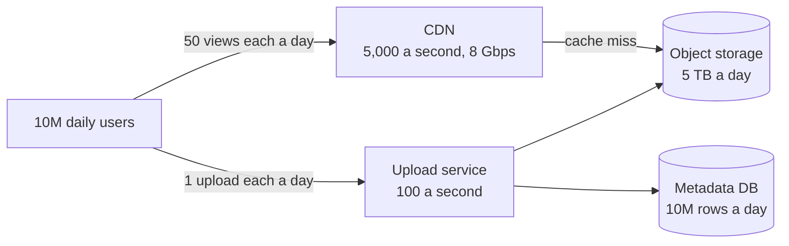

# Back of the Envelope Math

> Back of the envelope math is estimating traffic, storage, and bandwidth in a few minutes with round numbers. Landing within a factor of 10 of the truth is enough to pick the right design.


## How it works

Round hard and keep your units straight. A few facts carry most estimates:

- **A day is about 100,000 seconds.** It's really 86,400, but round it. So 1 million requests a day is about 10 per second.
- **Peak is 2 to 10 times the average.** Lunch, evenings, and launches pile up. Size for the peak.
- **Each unit is 1,000 times the last.** KB, MB, GB, TB, PB. A million users times 1 KB each is 1 GB.

With those, three formulas cover most questions. Requests per second is daily users times actions per user, divided by 100,000. Storage is new items per day times their size times the days you keep them. Bandwidth is requests per second times the size of each response.

Work in powers of ten and let the zeros cancel. 10 million users times 50 views is 500 million, and 500 million divided by 100,000 is 5,000 per second. No calculator needed.

The point isn't the exact answer. It's learning which part is big. 10 writes per second fits on one small database, and 100,000 per second does not. 2 GB fits in memory, and 2 PB needs object storage.

The catch: raw data is never the whole bill. Indexes, backups, and thumbnails add more, and if you run your own storage you usually keep 3 copies of every byte. Managed object storage like S3 includes its copies in the price, but the extras still count.

## Example

Estimate a photo sharing app with 10 million daily users. Each uploads 1 photo a day, compressed to about 500 KB, and scrolls past 50 photos at about 200 KB each.

```text
Uploads:   10M x 1  / 100K s  = 100 a second, peak ~300
Views:     10M x 50 / 100K s  = 5,000 a second, peak ~15,000
Storage:   10M x 500 KB       = 5 TB a day, ~2 PB a year
Bandwidth: 5,000 x 200 KB     = 1 GB/s, about 8 Gbps
```

Uploads are easy. A few servers handle 300 a second. Views are not, because 8 Gbps on average, and around 24 at peak, belongs on a CDN rather than your app servers. Storage is the big one: 2 PB a year, before thumbnails and backups, means object storage and a plan for old photos.

Ten minutes of arithmetic, and the three biggest design decisions are already made.

## Picture it



Every number on the diagram came from one multiplication and one division. The labels already tell you where the pressure is: bandwidth on the CDN side, storage on the right.

## Related

[Throughput](throughput.md) · [Latency](latency.md) · [Object Storage](../08-storage/object-storage.md) · [CDN](../03-traffic/cdn.md) · [Capacity Planning](../22-operations/capacity-planning.md)

---

[← Little's Law](littles-law.md) · [All concepts](../../README.md) · [Vertical Scaling →](../02-scaling/vertical-scaling.md)
