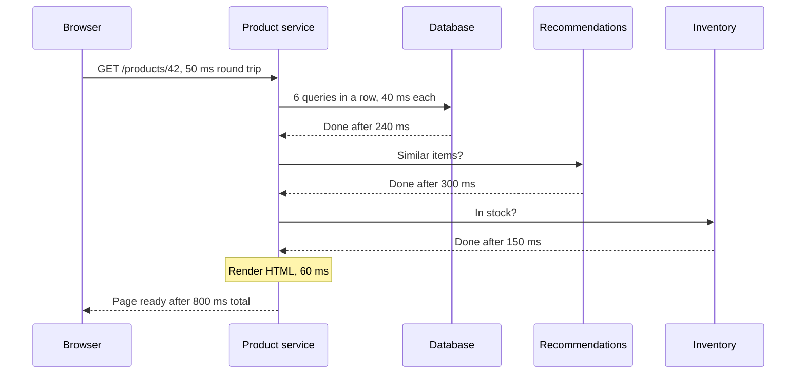

# Latency

> Latency is how long one request takes, from the moment it leaves the client to the moment the answer lands. Users feel every millisecond of it, so it's the number they actually judge you on.

## How it works

A request's time is a sum of small waits. Most of them have nothing to do with how fast your code runs.

- **Network.** Every round trip costs time, and distance sets the floor. Inside one data center a trip takes under a millisecond. A round trip from New York to London takes about 70 ms, because light in fiber is only so fast.
- **Queueing.** Waiting in line for a free thread, connection, or CPU core. Under load this is often the biggest piece, and the one nobody measures.
- **Processing.** Your code running: parsing input, business logic, turning objects into JSON.
- **Disk and database.** Reading memory takes about 100 nanoseconds. Reading an SSD takes about 100 microseconds, a thousand times longer. A database query adds a network hop on top of its own work.

Waits in a row add up. Three calls of 30 ms, one after another, cost 90 ms. The same three calls in parallel cost about 30 ms, the time of the slowest one. So the usual fixes are fewer round trips, data closer to the user, independent calls run side by side, and short queues.

Watch out: averages lie. If 99 requests take 50 ms and one takes 5 seconds, the average is about 100 ms, a number that describes nobody. The users you lose live in the slow end, so measure percentiles instead. That's what [P99 Latency](p99-latency.md) is for.

## Example

An online store's product page takes 800 ms. Nobody's code is slow. The time breaks down like this: 50 ms of network, six database queries run one after another at 40 ms each (240 ms), a call to the recommendations service (300 ms), a call to inventory (150 ms), and 60 ms to render the HTML.

Two changes, no new hardware. The six queries become one query that fetches everything, so 240 ms becomes 40 ms. Recommendations and inventory don't depend on each other, so they run in parallel and cost 300 ms together instead of 450.

The page now loads in 450 ms. Same servers, same code speed, just fewer waits stacked on top of each other.

## Picture it

Each arrow waits for the one before it, so the times stack up to 800 ms. Nothing here is slow on its own. The page is slow because every wait happens in a row.

## Related

[P99 Latency](p99-latency.md) · [Tail Latency](tail-latency.md) · [Throughput](throughput.md) · [CDN](../03-traffic/cdn.md) · [Caching](../06-caching/caching.md)

---

[All concepts](../../README.md) · [Throughput →](throughput.md)
