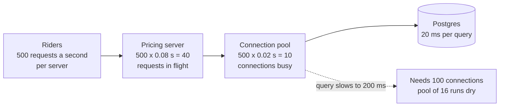

# Little's Law

> Little's Law says the number of requests in flight equals the arrival rate times how long each one stays. Know any two and you get the third, which is how you size thread pools, connection pools, and queues.

## How it works

A coffee shop gets 2 customers a minute, and each stays 5 minutes. On average, 10 people are inside. That's the whole law: `L = λ × W`. L is how many are in the system, λ (lambda) is the arrival rate, and W is the time each one spends inside, waiting included. It holds for any system that's keeping up, no matter how the arrivals are spread out.

For a server: 500 requests per second, each taking 200 ms, means 500 x 0.2 = 100 requests in flight at any moment. Each of those is holding something, so the number tells you what to provision:

- **Thread pools.** Threads needed = requests per second x seconds per request. Add headroom for spikes.
- **Connection pools.** 2,000 queries a second at 5 ms each keeps 10 database connections busy. A pool of 15 is plenty.
- **Queues.** Flip it around: W = L / λ. A queue holding 6,000 messages, with 200 arriving and 200 leaving per second, means each message waits about 30 seconds.

The catch: W includes waiting, and it's the number that changes on a bad day. If a dependency slows from 50 ms to 2 seconds, L jumps 40 times at the same traffic, and a pool sized for normal days is suddenly full. That's how one slow database takes down a healthy service. Timeouts cap W, and capping W caps L.

## Example

A ride sharing app's pricing service runs on 4 servers. At the Friday night peak it gets 2,000 requests per second, so 500 per server. Each request takes 80 ms end to end and holds a database connection for 20 ms of that.

Threads per server: 500 x 0.08 = 40 busy on average, so the pool gets 64. Connections per server: 500 x 0.02 = 10 busy on average, so the pool gets 16. Across 4 servers that's 64 connections, well under the default Postgres limit of 100.

Then someone drops an index by mistake, and the query now takes 200 ms. Same traffic, but now each server needs 500 x 0.2 = 100 connections. The pool of 16 runs dry, requests line up waiting for a connection, and response times climb into seconds. Nothing about the traffic changed. Only W did.

## Picture it

Each box applies the same formula: arrival rate times time spent. The dotted path shows the bad day, where traffic stays flat but a slower query multiplies the connections needed by ten.

## Related

[Throughput](throughput.md) · [Latency](latency.md) · [Connection Pooling](../07-databases/connection-pooling.md) · [Message Queues](../13-messaging/message-queues.md) · [Kingman's Formula](../23-laws/kingmans-formula.md)

---

[← Tail Latency](tail-latency.md) · [All concepts](../../README.md) · [Back of the Envelope Math →](back-of-the-envelope-math.md)
