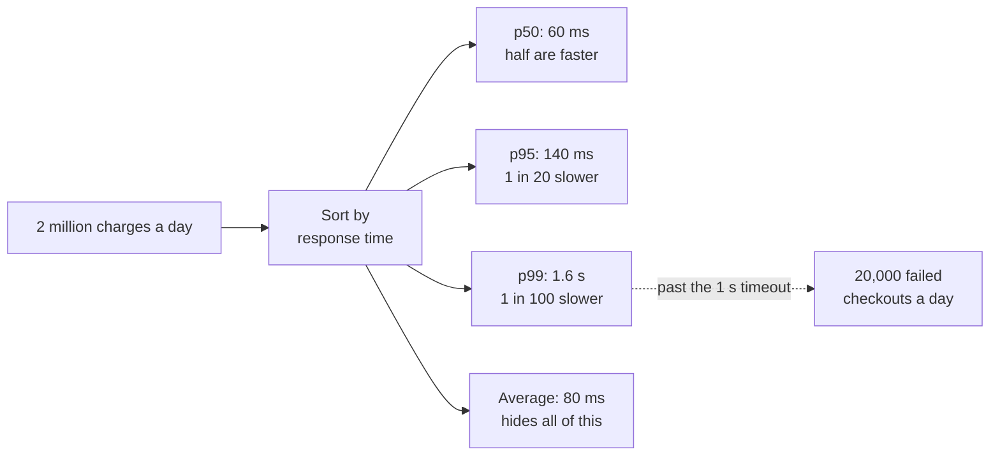

# P99 Latency

> P99 latency is the response time that 99 percent of requests beat. It shows how slow things get for the unlucky 1 in 100, which an average hides completely.

## How it works

Take every request from the last minute and sort them by how long they took. Percentiles are just spots along that line.

| Percentile | What it means | Typical value |
|---|---|---|
| p50, the median | Half of requests are faster | 60 ms |
| p95 | 1 in 20 is slower | 140 ms |
| p99 | 1 in 100 is slower | 1.6 s |
| p99.9 | 1 in 1,000 is slower | 3 s |

Read them as a shape. If p50 and p99 sit close together, the service is consistent. A big gap means most requests are fine but something hurts a few: a garbage collection pause (the runtime freezing to clean up memory), a cold cache, one overloaded database shard, a retry.

Why care about 1 percent? Because users don't make one request. A single page load can make 30, and a session can make hundreds. With 100 requests in a session, about 63 percent of sessions hit at least one request slower than p99. The slow 1 percent of requests touches most of your users. Amazon's Dynamo paper describes setting its performance targets at the 99.9th percentile, not the average.

Watch out: you can't average percentiles. If 10 servers each report a p99, the average of those 10 numbers is not the fleet's p99. Merge the raw data first, then compute. Tools like Prometheus do this when you record histograms, which count requests per latency bucket.

## Example

A payments API handles 2 million charges a day. The dashboard shows an average of 80 ms, and the team is happy. Merchants are not. Their checkout pages give up on a charge after 1 second, and some of them see failed checkouts every few minutes.

The team adds percentiles: p50 is 60 ms, p95 is 140 ms, p99 is 1.6 seconds. So at least 1 in 100 charges blows past the merchants' timeout. At 2 million charges a day, that's 20,000 or more failed checkouts, invisible in the average.

The cause is garbage collection. Every so often the process freezes for over a second to clean up memory, and every request in flight at that moment waits. After switching to a garbage collector built for short pauses, p99 drops to 250 ms. The average only drops from 80 ms to 65 ms, and both numbers look healthy, which is exactly why nobody saw the problem.

## Picture it

Sort the requests and the percentiles fall out. The average sits next to p50 and looks healthy, while the p99 branch is where merchants lose 20,000 checkouts a day.

## Related

[Latency](latency.md) · [Tail Latency](tail-latency.md) · [Metrics](../18-observability/metrics.md) · [SLOs](../18-observability/slos.md) · [Garbage Collection](../12-concurrency/garbage-collection.md)
