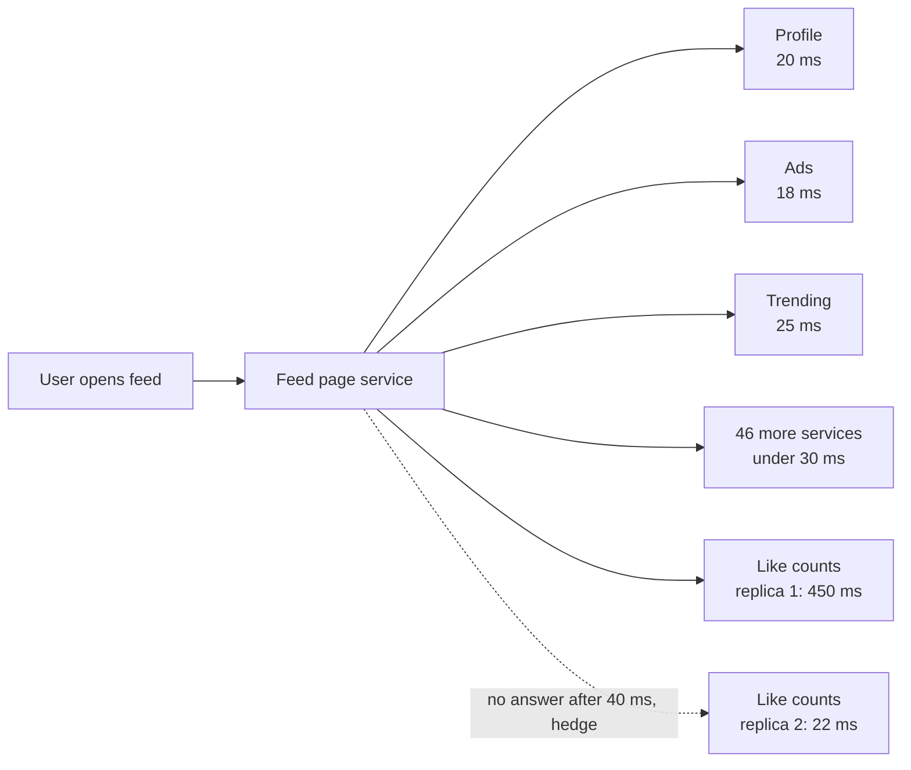

# Tail Latency

> Tail latency is the slow end of your response times, the p99 and beyond. When one request fans out to many services, it waits for the slowest one, so rare slowness in each service becomes common slowness for users.

## How it works

A modern page rarely comes from one service. Loading a feed might call 50 services in parallel: profile, ads, notifications, like counts, and so on. The page can't finish until the last answer arrives.

Say each service is fast 99 percent of the time and slow 1 percent of the time. Alone, that's fine. But the chance that all 50 are fast on the same page load is 0.99 to the 50th power, about 60 percent. So roughly 4 in 10 page loads hit at least one slow call. Google's paper "The Tail at Scale" runs the same math with 100 servers and gets 63 percent of requests slow.

You can't make every service perfect, so you design around the tail:

- **Timeouts.** Give each call a deadline. If an optional widget misses it, render the page without it.
- **Hedged requests.** Send a read to one replica. If it hasn't answered by about its p95 time, send a copy to a second replica and use whichever answers first. It costs a few percent more traffic and cuts the tail sharply.
- **Fewer fan outs.** Every extra dependency is one more chance to be slow.
- **Fix the usual sources.** Garbage collection pauses, background jobs on the same machine, other workloads hogging shared hardware.

Watch out: only hedge requests that are safe to run twice, like reads. A hedged payment can charge twice. And cap the extra copies. If a service is slow because it's overloaded, a flood of duplicates makes it worse.

## Example

A social app's home feed calls 50 backend services in parallel. Each one has a p50 of 20 ms and a p99 of 200 ms, and every team's dashboard looks great. But the page waits for the slowest of the 50, so about 40 percent of feed loads take over 200 ms, and the page's p99 is 900 ms. Something is always slow somewhere.

Two changes fix most of it. Optional pieces like ads and trending topics get a 150 ms timeout and render empty if they miss it. Required pieces, like posts and like counts, get hedged reads: if a replica hasn't answered in 40 ms, about its p95, a second replica gets the same request. That adds around 5 percent more calls to those services.

The page's p99 falls from 900 ms to 180 ms. No service got faster. The page just stopped waiting on bad luck.

## Picture it

The page waits for every arrow, so one slow replica would set the speed for the whole page. The dotted hedge asks a second replica after 40 ms, and the page takes whichever answer lands first.

## Related

[P99 Latency](p99-latency.md) · [Latency](latency.md) · [Timeouts](../14-reliability/timeouts.md) · [Idempotency](../14-reliability/idempotency.md) · [Graceful Degradation](../14-reliability/graceful-degradation.md)
