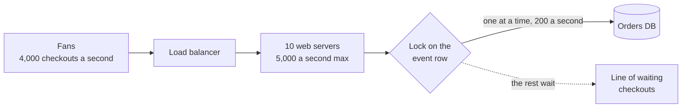

# Throughput

> Throughput is how much work a system finishes per second, counted in requests, messages, or bytes. Latency is how long one job takes, and throughput is how many jobs get done.

## How it works

Picture a highway. Latency is how long your drive takes. Throughput is how many cars pass a point each hour. Adding lanes raises throughput without making any single car faster.

Servers work the same way. A server that handles one request at a time, at 100 ms each, does 10 requests per second. Give it 8 workers and it does 80, while each request still takes 100 ms. Batching is another lever: one insert of 1,000 rows beats 1,000 separate inserts, but each row now waits for its batch to fill. More throughput, more latency.

A system moves only as fast as its slowest step, called the bottleneck. If your web servers can handle 5,000 requests per second and the database tops out at 1,200 queries per second, with one query per request, you have a 1,200 per second system. More web servers change nothing. To find the bottleneck, look for the resource pinned at 100 percent while the others idle: CPU, disk, connections, or a single lock.

The catch: running near the limit wrecks latency. As a resource gets close to fully busy, requests start waiting in line, and the wait grows much faster than the load. Going from 70 to 95 percent busy can make response times several times worse. Plan to run around 70 percent and keep the rest for bursts.

## Example

A ticketing site puts a big concert on sale at 10:00. About 4,000 fans try to check out every second. The site has 10 web servers that handle 500 requests per second each, so 5,000 total. Plenty, on paper.

Checkout reserves seats by locking the event's row in the database, and each reservation holds that lock for 5 ms. Only one reservation can hold it at a time, so the whole site tops out at 200 checkouts per second, no matter how many web servers you add. Fans stare at spinners while the web servers sit mostly idle.

The fix is to lock each section instead of the whole event. With 40 sections, up to 40 reservations run at once, and the limit jumps to around 8,000 per second. Now the web tier is the bottleneck again, and that one you can fix by adding servers.

## Picture it

The web tier could handle 5,000 checkouts a second, but every one squeezes through a single lock. The system's throughput is set by that narrow point, not by the size of anything around it.

## Related

[Latency](latency.md) · [Little's Law](littles-law.md) · [Back of the Envelope Math](back-of-the-envelope-math.md) · [Horizontal Scaling](../02-scaling/horizontal-scaling.md) · [Universal Scalability Law](../23-laws/universal-scalability-law.md)

---

[← Latency](latency.md) · [All concepts](../../README.md) · [P99 Latency →](p99-latency.md)
