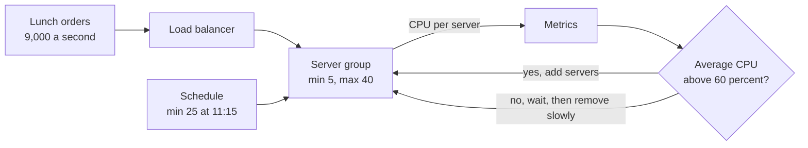

# Autoscaling

> Autoscaling adds servers when load rises and removes them when it falls, based on a metric you pick. You pay for the traffic you have, not the traffic you're afraid of.

## How it works

A controller watches a metric across a group of servers and resizes the group to keep that metric near a target. The Kubernetes Horizontal Pod Autoscaler checks every 15 seconds by default. The common styles:

- **Target tracking.** "Keep average CPU at 60 percent." Above it, add servers. Below it, remove some.
- **Step rules.** "If the queue holds more than 1,000 jobs, add 5 workers."
- **Scheduled.** Traffic you can predict, like a lunch rush, gets capacity before it arrives.
- **Predictive.** Some clouds learn your daily pattern from past weeks and scale ahead of it.

Pick a metric that tracks real load. CPU works for compute heavy services, requests per server works for web APIs, and queue depth works for background workers. Set a minimum so you never drop too low, and a maximum so a bug or an attack can't run up a huge bill. Scale up fast and scale down slowly, or the group flaps, adding and removing the same servers every few minutes.

All of this assumes [stateless services](stateless-services.md). If removing a server loses user data, you can't let a robot remove servers.

The catch: new servers aren't instant. Booting, pulling the image, warming up, and passing health checks can take 2 to 5 minutes. A spike that doubles traffic in 30 seconds has already hurt users by the time help arrives. Keep headroom by targeting 60 percent instead of 90, and schedule the peaks you know about.

## Example

A food delivery app gets 1,500 requests per second at 10 am and 9,000 at 12:15. Each server handles 300 per second at 60 percent CPU, so it needs 5 servers in the morning and 30 at lunch.

With target tracking alone, lunch goes badly. Traffic climbs from 1,500 to 9,000 in about 15 minutes, new servers take 4 minutes to be ready, and the group is always a few servers behind. Latency spikes and some orders fail right when people are hungriest.

The fix adds a schedule. At 11:15 the minimum jumps to 25 servers, so lunch starts warm, and target tracking covers whatever extra shows up. At 2 pm the minimum drops back to 5, and the group shrinks slowly over the next hour. They pay for 30 servers for about 3 hours a day, not 24.

## Picture it

The loop on the right runs all day: measure, compare to the target, resize. The schedule on the bottom jumps ahead of the loop for the rush everyone knows is coming.

## Related

[Horizontal Scaling](horizontal-scaling.md) · [Stateless Services](stateless-services.md) · [Health Checks](../14-reliability/health-checks.md) · [Cold Starts](../15-architecture/cold-starts.md) · [Cost Optimization](../22-operations/cost-optimization.md)
