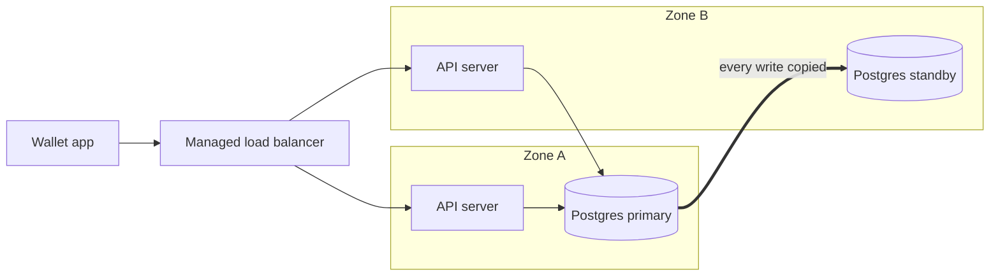

# High Availability

> High availability means a system keeps serving through the failures that will happen anyway: dead servers, bad disks, a lost data center. It's measured in nines, and each extra nine costs far more than the last.

## How it works

Availability is the share of time the system works. The nines turn into a downtime budget:

| Availability | Downtime per year | Downtime per month |
|---|---|---|
| 99% | about 3.65 days | about 7.3 hours |
| 99.9% | about 8.8 hours | about 44 minutes |
| 99.99% | about 53 minutes | about 4.4 minutes |
| 99.999% | about 5 minutes | about 26 seconds |

Redundancy is how you climb. Parts in a chain multiply: a load balancer, an app server, and a database at 99.9 percent each give you about 99.7 percent together, worse than any one of them. Parts side by side work the other way. Two independent servers at 99 percent are both down only 1 percent of 1 percent of the time, so together they reach 99.99 percent.

So the recipe is no single copy of anything on the request path, copies spread across zones, health checks that notice failure in seconds, and automatic failover. At four nines you get 53 minutes a year, which doesn't leave time for a human to wake up and fix things by hand.

The catch: the math assumes failures are independent, and they often aren't. Two servers behind the same rack switch die together. One bad config pushed everywhere takes out every copy at once. Google's SRE book puts changes to a live system behind roughly 70 percent of outages, so careful rollouts matter as much as spare servers.

## Example

A wallet app runs one API server and one Postgres database, each up about 99.5 percent of the time. In a chain that's 99.5 x 99.5, about 99 percent, or more than 3 days of downtime a year. For an app holding people's money, that's not OK. The target is 99.95 percent, about 4.4 hours a year.

The new setup puts an API server in each of two zones behind a managed load balancer. Postgres gets a standby in the second zone that receives every write as it happens and takes over in about a minute if the primary dies. Losing a server, a disk, or a whole zone now costs a minute, not a day.

The weak spots left are the load balancer and the database failover, each around 99.99 percent. Together that's about 99.98 percent, under 2 hours a year, well inside the target.

## Picture it

Every box on the request path has a twin in the other zone. Zone A can go dark and the load balancer sends traffic to Zone B, where the standby is promoted to primary.

## Related

[Single Point of Failure](single-point-of-failure.md) · [Failover](../21-disaster-recovery/failover.md) · [SLOs](../18-observability/slos.md) · [Active/Active vs Active/Passive](../21-disaster-recovery/active-active-vs-active-passive.md) · [Multi Region Deployment](../21-disaster-recovery/multi-region-deployment.md)

---

[← Single Point of Failure](single-point-of-failure.md) · [All concepts](../../README.md) · [Load Balancing →](../03-traffic/load-balancing.md)
