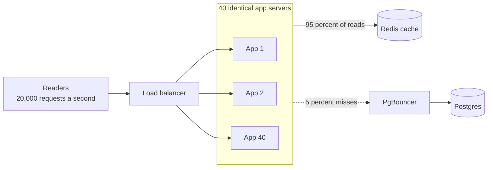

# Horizontal Scaling

> Horizontal scaling means adding more machines instead of bigger ones. Ten small servers behind a load balancer can take ten times the traffic, and losing one of them is a shrug, not an outage.

## How it works

Run several identical copies of your app and put a load balancer in front to spread requests across them. Need more capacity? Add copies. Traffic drops at night? Remove some. There's no hard ceiling, and when one server dies, you lose a slice of capacity instead of the whole site.

It only works if the copies are interchangeable. Any server must be able to handle any request, so no user data can live in one server's memory or on its disk. Sessions, uploads, and caches move to shared stores. That's what makes a service [stateless](stateless-services.md).

App servers are the easy part. Data is harder. A database can spread reads across [read replicas](../09-data-at-scale/read-replicas.md), but spreading writes means sharding, splitting the data so each machine owns a piece. That's a big step, so most teams scale the app tier out and the database up for as long as they can.

The tradeoff is more moving parts: more machines to deploy, more network calls, and partial failures, where some servers are healthy and some aren't.

The catch: scaling out the app tier pushes the load straight onto whatever those servers share. Ten app servers holding 50 database connections each is 500 connections to one Postgres. Add servers at the front, and the shared database becomes the next bottleneck.

## Example

A news site normally serves 2,000 requests per second from 4 app servers. On election night it expects 10 times that, so the team scales to 40 servers. The app servers cope fine. The database doesn't. Each server opens 20 connections, 800 in total, far more than Postgres is set up to accept. New connections get refused, and pages start timing out at 9 pm, right as results come in.

The fix has two parts. A connection pooler, PgBouncer, sits in front of Postgres and shares 100 real connections among all 40 servers. And since every reader wants the same few articles, rendered pages go into Redis for 30 seconds, so about 95 percent of requests never touch the database.

Scaling out worked once the thing all 40 servers shared stopped being the choke point.

## Picture it

The app tier grows by adding identical boxes, and the load balancer doesn't care which one answers. What matters is the right side: everything the boxes share has to survive 40 of them at once.

## Related

[Vertical Scaling](vertical-scaling.md) · [Stateless Services](stateless-services.md) · [Load Balancing](../03-traffic/load-balancing.md) · [Autoscaling](autoscaling.md) · [Amdahl's Law](../23-laws/amdahls-law.md)
