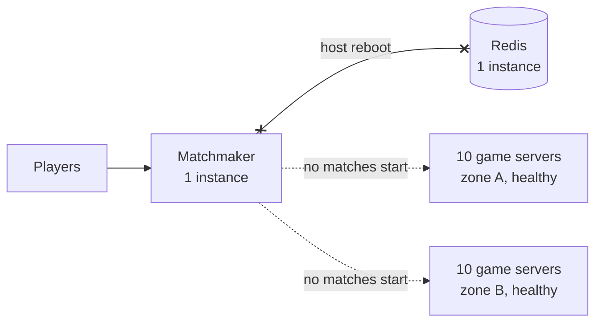

# Single Point of Failure

> A single point of failure is one part whose failure takes the whole system down with it. Every system starts with a few, so the job is to find them before they find you.

## How it works

To spot one, draw the path a request takes from the user to the data, every box and every arrow. Point at each one and ask: if this vanished right now, what breaks? If the answer is "everything", you found one.

The usual suspects:

- **The one database.** A primary with no replica, or a replica nobody can promote quickly.
- **The load balancer itself.** You added 10 app servers behind one load balancer box.
- **Shared dependencies.** One Redis, one auth service, or one DNS provider that every request needs.
- **One location.** Every server in the same zone, meaning one data center or a few close together, or in the same region.
- **One person or one manual step.** The only engineer who knows the deploy, or the certificate someone renews by hand.

Removing one comes down to three moves. Add a second copy in a separate failure domain, meaning a machine, rack, or zone that won't fail for the same reason. Detect failure with health checks and switch over automatically. Or make the dependency optional, so the system limps along without it instead of dying.

Watch out: a backup you've never tested isn't a backup. A standby in the same rack, two servers on one power supply, or a failover script nobody has run are single points of failure in disguise. Turn things off on purpose and see what happens. That's the idea behind chaos engineering.

## Example

A multiplayer game runs 20 game servers, 10 in each of two zones. It looks redundant. But every player who wants a match goes through one matchmaking service on one virtual machine, and it keeps the queue in one Redis instance.

One Tuesday the cloud provider reboots the host under that Redis for maintenance. For 25 minutes nobody can start a match, while all 20 game servers sit healthy and empty.

The fix: 3 matchmaker instances behind a load balancer, spread across both zones, plus a managed Redis with a replica in the other zone and automatic failover. The next host reboot triggers a failover that takes about 20 seconds. Players in the queue see a short pause, then a match.

## Picture it

The game servers are redundant across two zones, but every match starts at one matchmaker and one Redis. Lose either of them and 20 healthy servers sit empty.

## Related

[High Availability](high-availability.md) · [Failover](../21-disaster-recovery/failover.md) · [Replication](../09-data-at-scale/replication.md) · [Chaos Engineering](../14-reliability/chaos-engineering.md) · [Health Checks](../14-reliability/health-checks.md)
