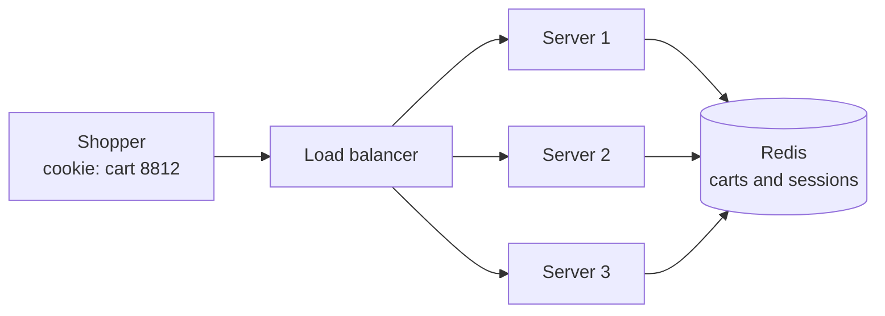

# Stateless Services

> A stateless service keeps nothing about users in its own memory between requests. Any server can handle any request, so you can add, remove, or restart servers and nobody notices.

## How it works

Each request carries what the server needs, like a session token or a cart ID. Anything that has to outlast the request lives somewhere shared: sessions in Redis, files in object storage, records in the database. The server reads what it needs, does the work, writes the result, and forgets.

State sneaks in through a few classic doors:

- **Sessions in memory.** The user logs in on server 1, the next click lands on server 2, and they're logged out.
- **Files on local disk.** An upload saved on one server is missing on the other nine.
- **Local caches as the truth.** A cache inside the process is fine as a speedup. It's a bug when it holds the only copy.

Another option is to carry the state in the request itself. A signed token, like a JWT, can hold the user's ID and roles, so the server checks the signature instead of looking anything up. That saves a lookup, but logging someone out early gets harder, because the token stays valid until it expires.

The payoff is big: horizontal scaling, autoscaling, rolling deploys, and crashes that lose nothing.

The catch: the state didn't disappear. It moved. Every request now pays a network hop to the shared store, often about a millisecond, and that store becomes the thing that can't go down. If it's one Redis box, you traded 10 fragile servers for 1. Run it replicated.

## Example

An online store keeps each shopper's cart in the memory of whichever server they hit first. There are 3 servers behind a round robin load balancer. A shopper adds sneakers on server 1. Their next click lands on server 2, and the cart is empty.

The quick fix is sticky sessions, which pin each shopper to one server. That works until the Friday deploy restarts server 1, and a third of all carts vanish in the middle of a sale.

The real fix: carts move to Redis, keyed by a cart ID stored in a cookie. Now any server can answer any click. Deploys restart servers whenever they like, and during the holiday rush the autoscaler adds 6 more servers without a single cart going missing.

## Picture it

The servers hold nothing worth keeping. Every one of them looks up cart 8812 in the same Redis, so the load balancer can send the shopper anywhere and a server can die without losing a thing.

## Related

[Horizontal Scaling](horizontal-scaling.md) · [Sticky Sessions](sticky-sessions.md) · [Autoscaling](autoscaling.md) · [Rolling Deployments](../20-releases/rolling-deployments.md) · [Object Storage](../08-storage/object-storage.md)

---

[← Horizontal Scaling](horizontal-scaling.md) · [All concepts](../../README.md) · [Sticky Sessions →](sticky-sessions.md)
