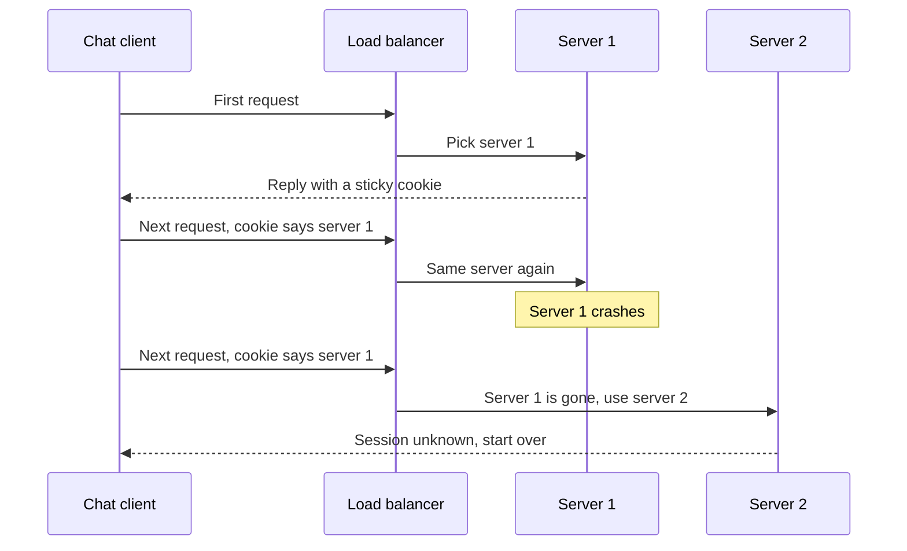

# Sticky Sessions

> Sticky sessions make a load balancer send every request from the same user to the same server. They're a quick fix for servers that keep state in memory, and they quietly undo much of what the load balancer was for.

## How it works

On the first request, the load balancer picks a server and remembers the choice, usually in a cookie it adds to the response. Every later request carries that cookie, so the load balancer routes it back to the same server. The AWS Application Load Balancer names its cookie `AWSALB`. The other common way is hashing the client's IP address, so the same IP always maps to the same server.

You reach for stickiness when a server holds something about a user in memory: a login session, a half finished upload, a warm local cache, or a real time connection.

It has costs:

- **Uneven load.** Heavy users stay stuck where they landed. With IP hashing, a whole office behind one IP address lands on one server.
- **Lost state when a server dies.** All of its users lose their sessions at once.
- **Lazy scale out.** A new server only gets new users. Everyone already pinned stays on the old, busy ones.
- **Slow deploys.** To take a server out cleanly, you wait for its sessions to drain.

Sometimes it's the right tool, like when a protocol needs several HTTP requests to reach the same process. For everything else, keep state in a shared store and make the service stateless.

The catch: treat stickiness as a speedup, never as a guarantee. If a user's session breaks when they land on a different server, you have a bug that's waiting for the next deploy or crash.

## Example

A chat app runs Socket.IO on 4 servers. By default, Socket.IO opens every connection with HTTP long polling, a series of requests that all belong to one session, and only then upgrades to a WebSocket. Round robin spreads those requests across servers, and the ones that land on the wrong server fail with "Session ID unknown". Users watch their chats connect, drop, and reconnect in a loop.

The fix comes straight from the Socket.IO docs, in two parts. Turn on cookie based stickiness at the load balancer, so every request in a session hits the same server. Then add the Redis adapter, so a message from a user on server 1 still reaches a friend connected to server 3.

The cost doesn't go away. When a server crashes, its 20,000 users lose their sessions and reconnect at once, piling onto the other three.

## Picture it

The cookie keeps the client on server 1 for as long as server 1 exists. When it crashes, the session in its memory goes with it, and the client starts from scratch on server 2.

## Related

[Stateless Services](stateless-services.md) · [Load Balancing](../03-traffic/load-balancing.md) · [WebSockets](../04-networking/websockets.md) · [Long Polling](../04-networking/long-polling.md) · [Pub/Sub](../13-messaging/pub-sub.md)

---

[← Stateless Services](stateless-services.md) · [All concepts](../../README.md) · [Autoscaling →](autoscaling.md)
