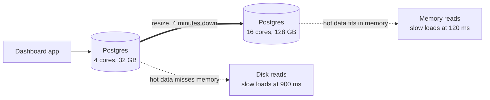

# Vertical Scaling

> Vertical scaling means making one machine bigger: more CPU, more memory, faster disks. It's the simplest way to handle more load, right up until you hit the biggest machine you can buy.

## How it works

You move your app or database from a machine with 4 cores and 16 GB of memory to one with 32 cores and 256 GB. No code changes, no new architecture. Everything that was cramped gets room: more queries in parallel, more data cached in memory, fewer trips to disk.

This is how most databases grow for a long time, because splitting a database across machines is hard. One big box keeps transactions, joins, and backups simple.

The limits show up eventually:

- **A ceiling.** The largest cloud machines have hundreds of cores and terabytes of memory. Past that, there's nowhere to go.
- **Downtime to resize.** Moving to a bigger machine usually means a restart or a failover.
- **Still one machine.** If it dies, everything on it dies with it. Bigger doesn't mean safer.
- **Paying for the peak.** You size for your busiest hour and pay for that size around the clock, even at 3 am.

The catch: a bigger machine only helps if the machine is the bottleneck. Some software can't use the extra cores. Redis runs commands on a single thread, and by default a Node.js process runs your JavaScript on one. If the real limit is one thread or one hot lock, 64 cores just means 63 idle ones.

## Example

A SaaS dashboard runs on one Postgres server with 4 cores and 32 GB of memory. The data has grown to 120 GB, and the tables customers query most no longer fit in memory, so reports read from disk. The slowest 5 percent of dashboard loads take over 900 ms.

The team resizes to 16 cores and 128 GB during a Sunday night maintenance window. The database is down for about 4 minutes. Now the hot data fits in memory, and the slowest 5 percent of loads drop to 120 ms.

The bill goes up about 4 times. Nobody touched the code or split the data, and it buys the team a year or two before they need read replicas.

## Picture it

Same database, same code, same data. The thick arrow is the only change: a bigger box, so the data customers ask for most comes from memory instead of disk.

## Related

[Horizontal Scaling](horizontal-scaling.md) · [Single Point of Failure](single-point-of-failure.md) · [Read Replicas](../09-data-at-scale/read-replicas.md) · [Sharding](../09-data-at-scale/sharding.md)
