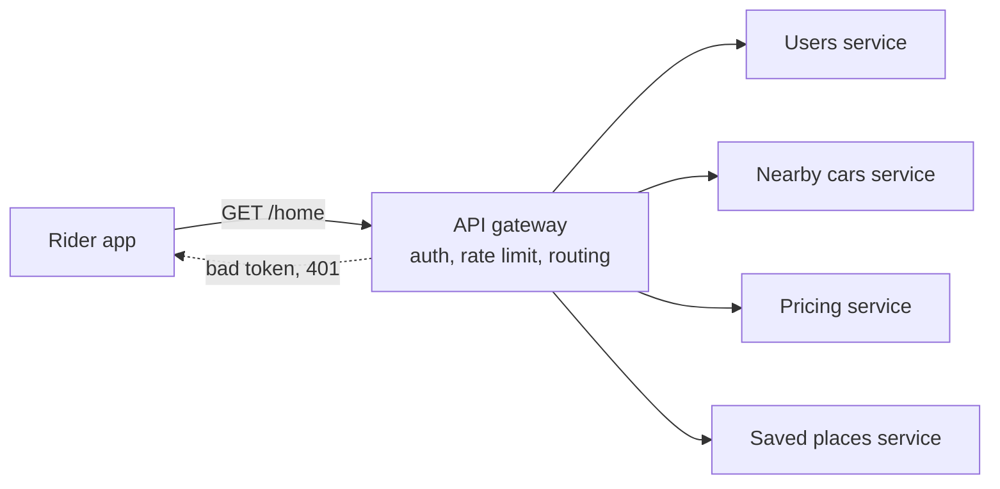

# API Gateways

> An API gateway is one front door for many backend services. Clients call one address, and the gateway handles routing, login checks, rate limits, and request shaping so each service doesn't have to.

## How it works

Once an app is split into many services, a mobile app might need users, trips, payments, and pricing. Without a gateway, the client has to know every address, and every service has to check logins, count requests, and log traffic on its own. Some team will forget.

The gateway does those chores once, at the front:

- **Routing.** `/trips/*` goes to the trips service and `/pay/*` to payments. Clients only ever see one hostname.
- **Auth.** Check the login token once and pass a trusted user ID to the services behind it.
- **Rate limiting.** Cap each API key or user before the traffic reaches anything expensive. See [Rate Limiting](rate-limiting.md).
- **Request shaping.** Rename fields, strip internal ones, translate JSON to gRPC, or merge several backend calls into the one response a phone screen needs.

Kong, AWS API Gateway, and Apigee are common products, and plenty of teams build their own on Envoy or nginx. A gateway is really a [reverse proxy](reverse-proxies.md) that knows about your API: who's calling, what plan they're on, and which service owns which path.

The catch: the gateway sits in front of every request, so it's tempting to put business logic in it. Don't. Once pricing rules live in gateway config, every product change waits on the team that owns the gateway, and one bad config push breaks every service at once. Keep it thin, and run several copies of it, because it's also a single point of failure.

## Example

A ride sharing app's home screen needs four things: the rider's profile, nearby cars, saved places, and a price estimate. At first the app calls four services directly. That's four hostnames, each with its own DNS lookup and TLS handshake over a slow mobile network, and four separate token checks. The saved places team forgot theirs, so anyone with a rider ID could read anyone's home address.

Now the app makes one call, `GET /home`, to the gateway. The gateway verifies the token once, rejects bad ones with a 401, and limits each rider to 60 requests a minute. Then it calls the four services in parallel over the fast internal network and merges the answers into one JSON response.

The phone talks to one hostname over one connection. The services accept traffic only from the gateway, so none of them can skip the token check again.

## Picture it

One request comes in and four go out, all on the internal network. The dotted line is the gateway turning away a bad token before any service has to deal with it.

## Related

[Rate Limiting](rate-limiting.md) · [Reverse Proxies](reverse-proxies.md) · [Monolith vs Microservices](../15-architecture/monolith-vs-microservices.md) · [Authentication vs Authorization](../16-identity-and-encryption/authentication-vs-authorization.md) · [Backend for Frontend](../15-architecture/backend-for-frontend.md)
