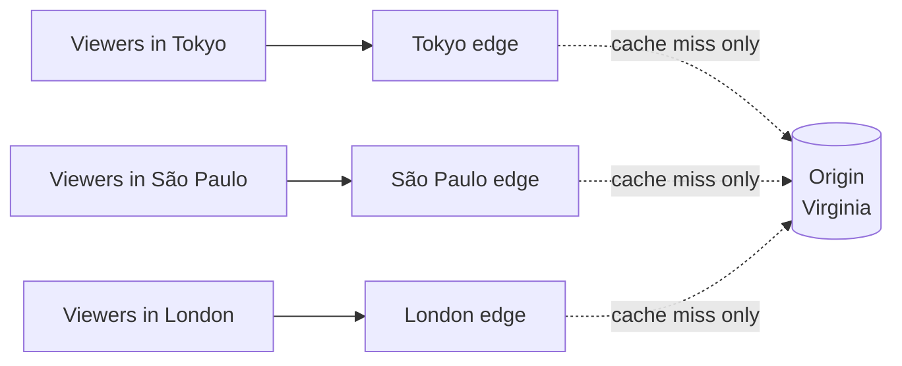

# CDN

> A CDN, or content delivery network, keeps copies of your static files on servers spread around the world. Users download from a server a few miles away instead of one across an ocean.

## How it works

The origin is where the real files live: your server or a storage bucket. A CDN like Cloudflare, Akamai, Fastly, or Amazon CloudFront runs edge locations, groups of cache servers in dozens to hundreds of cities. When a user asks for a file, the CDN's routing sends them to an edge nearby.

1. A user in Tokyo asks for `logo.png`, and the request goes to the Tokyo edge.
2. If the edge has a copy, a cache hit, it sends it back in a few milliseconds.
3. If not, a cache miss, the edge fetches it from the origin in Virginia, about 150 ms away, keeps a copy, and sends it on.
4. The next user in Tokyo gets the local copy.

Good fits are files that are the same for everyone: images, JavaScript, CSS, fonts, downloads, and video. You get three wins. Users wait less because the bytes travel a shorter distance. The origin serves a small slice of the traffic. And a sudden spike, or a flood of junk traffic, lands on hundreds of edge servers instead of your one origin.

The number to watch is the hit ratio, the share of requests the edge answers without asking the origin. At 95 percent, the origin sees 1 request in 20.

The catch: if you change a file but keep its name, users keep getting the old copy until the edge's copy expires. Put a content hash in the filename, like `app.3f9a2c.js`, so every deploy produces new URLs and the old copies simply stop being asked for.

## Example

A video streaming site keeps its videos in a storage bucket in Virginia. Players don't download a whole movie. They fetch it in small segments of a few seconds each, so a viewer watching at 4 Mbps pulls about 2 MB every 4 seconds.

On a Friday premiere, 50,000 people watch at once. Served straight from the origin, that's 200 Gbps out of one place, and viewers in São Paulo or Mumbai wait an extra 100 to 200 ms for every segment. Players start buffering.

With a CDN, the first viewer in each city triggers a miss, and the edge pulls that segment from the origin once. Everyone else in that city gets the local copy. At a 98 percent hit ratio, the origin sends about 4 Gbps, and viewers load each segment from a few miles away. The origin barely notices the premiere happened.

## Picture it

Solid arrows are the short trips every viewer makes to a nearby edge. The dotted arrows to Virginia only fire on a miss, which is why the origin sees a tiny fraction of the traffic.

## Related

[Edge Caching](edge-caching.md) · [Caching](../06-caching/caching.md) · [Latency](../01-performance/latency.md) · [Object Storage](../08-storage/object-storage.md) · [Anycast](../04-networking/anycast.md)

---

[← Rate Limiting](rate-limiting.md) · [All concepts](../../README.md) · [Edge Caching →](edge-caching.md)
