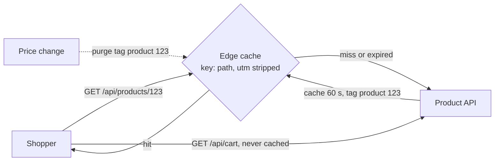

# Edge Caching

> Edge caching is the rulebook a CDN follows: what to cache, for how long, and how to tell two requests apart. Get the rules right and even API responses can be served from the edge.



## How it works

Four knobs decide what the edge does:

- **Cache key.** What makes two requests "the same". The default is usually host, path, and query string. Strip junk like `utm_source` from the key, or every marketing link gets its own copy. Add only what really changes the response, like language.
- **TTL.** Time to live, how long a copy counts as fresh. `max-age` sets it for every cache, and `s-maxage` overrides it for shared caches like the CDN.
- **Cache directives.** The `Cache-Control` header says who may cache. `public` lets anyone, `private` means only the user's browser, and `no-store` means nobody. `stale-while-revalidate` lets the edge serve a slightly old copy while it fetches a fresh one in the background.
- **Purging.** Removing copies before their TTL runs out, by URL or by tag. Tag every page that shows a product with its product ID, and one purge clears them all. Most CDNs finish a purge within seconds.

That's how APIs get cached too. Any response that's the same for every user can live at the edge: a product listing, a match score, search suggestions. Even a 5 second TTL turns a thousand identical requests at one edge into one request to your origin.

The catch: caching something personal. If `/api/account` gets cached under a shared key, the next user sees the previous user's account. A caching config change at Steam in 2015 did exactly this, showing some users pages generated for other users. Anything that depends on a login cookie or an `Authorization` header must be `private` or `no-store`.

## Example

An online store runs a flash sale, and product pages take 40,000 requests a second. The product API sits behind Fastly, a CDN, but almost nothing gets cached. Responses go out with no caching headers, and every newsletter link adds `utm_source` and `utm_campaign`, so the same product has hundreds of different cache keys.

The team sets three rules. Product responses get a 60 second edge TTL, a 30 second stale window, and a tag with the product ID. The CDN drops `utm_*` parameters from the cache key. Cart and account endpoints get `private, no-store`.

```http
HTTP/1.1 200 OK
Cache-Control: public, s-maxage=60, stale-while-revalidate=30
Surrogate-Key: product-123
```

When a price changes, the admin tool purges that product's tag, and every edge drops its copy within seconds. Origin traffic falls from 40,000 requests a second to under 1,000, and carts still go to the origin every time.

## Picture it



Product data is the same for everyone, so the edge answers most requests itself and only asks the origin when its copy expires or a price change purges the tag. The cart is personal, so it is never cached and always reaches the origin.

## Related

[CDN](cdn.md) · [Cache Invalidation](../06-caching/cache-invalidation.md) · [Caching Strategies](../06-caching/caching-strategies.md) · [Cache Stampede](../06-caching/cache-stampede.md) · [Reverse Proxies](reverse-proxies.md)

---

[← CDN](cdn.md) · [All concepts](../../README.md) · [DNS →](../04-networking/dns.md)
