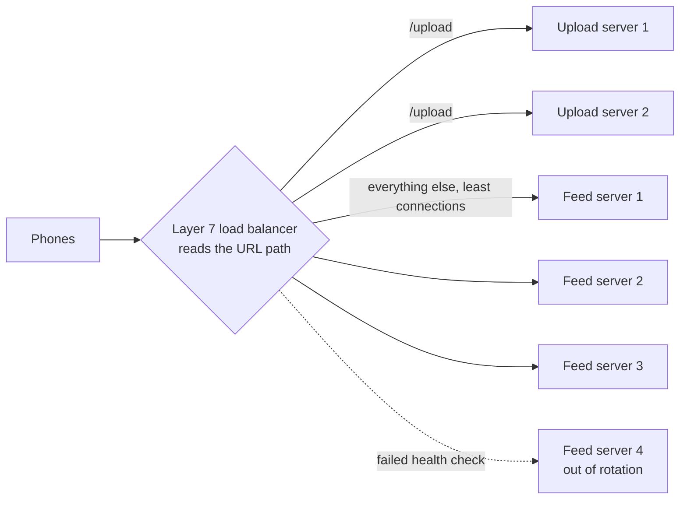

# Load Balancing

> A load balancer sits in front of a group of servers and spreads incoming requests across them. Users see one address, and no server gets buried while its neighbors sit idle.



## How it works

The load balancer runs health checks, pinging each server every few seconds and pulling dead ones out of rotation. Then, for each request, it picks a server:

- **Round robin.** Each server takes the next turn. Simple and fair when requests cost about the same.
- **Least connections.** Send to the server with the fewest requests in progress. Better when some requests take 10 ms and others take 10 seconds.
- **Hashing.** Hash a key, like the user ID or the URL, so the same key always lands on the same server. Good for keeping a server's cache warm. Consistent hashing keeps most keys in place when servers come and go.
- **Weighted.** Bigger servers get a bigger share of any of the above.

Load balancers also differ in how much of the request they read. A layer 4 load balancer sees only IP addresses and ports. It forwards TCP connections without looking inside, so it's fast and works for any protocol, but it can't tell `/api` from `/images`. A layer 7 load balancer reads the HTTP request: path, headers, cookies. It can route by URL, terminate TLS, and retry a failed request on another server. More work per request, much more control.

The catch: a layer 4 load balancer spreads connections, not requests. HTTP/2 and gRPC send thousands of requests over one long lived connection, so a layer 4 balancer can pin all of a client's traffic on one server while the rest stay idle. Use a layer 7 balancer that understands HTTP/2, or balance on the client side.

## Example

A photo sharing app runs 6 servers behind round robin. Most requests are feed views that take 20 ms. About 1 in 50 is an upload that takes 3 seconds to resize. Round robin counts requests, not work, so one server can end up holding several uploads while its neighbor holds none, and the feed views queued behind those uploads wait. Feed p99 hits 2 seconds while the average looks fine.

The fix is a layer 7 rule plus a better algorithm. `/upload` goes to its own pool of 2 servers, and the other 4 serve the feed with least connections.

```nginx
upstream uploads { least_conn; server up1:8080; server up2:8080; }
upstream feed {
  least_conn;
  server feed1:8080; server feed2:8080;
  server feed3:8080; server feed4:8080;
}
server {
  listen 80;
  location /upload { proxy_pass http://uploads; }
  location /       { proxy_pass http://feed; }
}
```

Feed p99 drops from 2 seconds to 80 ms.

## Picture it



Slow uploads and fast feed views no longer share servers, so a pile of uploads can't stall the feed. The dotted line is the health check at work: feed server 4 stopped answering, so it gets no traffic until it recovers.

## Related

[Reverse Proxies](reverse-proxies.md) · [Sticky Sessions](../02-scaling/sticky-sessions.md) · [Consistent Hashing](../09-data-at-scale/consistent-hashing.md) · [Health Checks](../14-reliability/health-checks.md) · [gRPC](../05-apis/grpc.md)

---

[← High Availability](../02-scaling/high-availability.md) · [All concepts](../../README.md) · [Reverse Proxies →](reverse-proxies.md)
