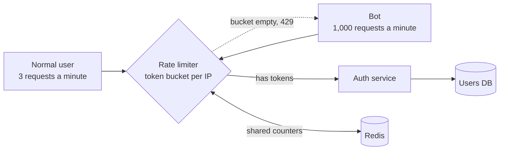

# Rate Limiting

> Rate limiting caps how many requests a client can send in a window of time. One noisy client gets slowed down, and everyone else keeps a fast service.

## How it works

Every request carries an identity: an API key, a user ID, or an IP address. The rate limiter keeps a counter for each identity and checks it before the request reaches your code. Under the limit, the request goes through. Over it, the client gets `429 Too Many Requests`, often with a `Retry-After` header that says when to come back.

There are a few classic ways to count:

- **Fixed window.** Count requests per calendar minute. Simple, but a client can fire a full burst at 12:00:59 and another at 12:01:00.
- **Sliding window.** Count the last 60 seconds from right now. Smoother, a little more work.
- **Token bucket.** Each client gets a bucket that refills at a steady rate, and every request spends one token. Short bursts are fine. Long floods are not.
- **Leaky bucket.** Requests drain out at a fixed pace, like water from a hole. Good for protecting a fragile backend.

The catch: if you run 10 servers and each one counts on its own, a client can get 10 times the limit. Keep the counters in one fast shared store like Redis, or enforce the limit in one place, like your API gateway.

## Example

Your login endpoint allows 5 attempts per minute per IP address. A bot shows up and starts guessing passwords at 1,000 attempts per minute.

Without a limit, all 1,000 attempts hit your auth service and your users database every minute. With a token bucket in the API gateway, the bot gets 5 tries and then a wall of 429 responses. The database never feels it. A real user who mistypes their password twice never notices the limiter exists.

```http
HTTP/1.1 429 Too Many Requests
Retry-After: 42
```

## Picture it



Both clients hit the same limiter. The normal user always has tokens left, so their requests pass. The bot empties its bucket in seconds and bounces off with a 429, so the auth service and the database stay calm.

## Related

[API Gateways](api-gateways.md) · [Load Shedding](../14-reliability/load-shedding.md) · [Backpressure](../13-messaging/backpressure.md) · [DDoS Protection](../17-web-security/ddos-protection.md) · [Exponential Backoff](../14-reliability/exponential-backoff.md)

---

[← API Gateways](api-gateways.md) · [All concepts](../../README.md) · [CDN →](cdn.md)
