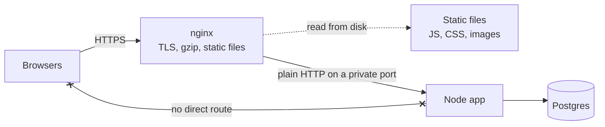

# Reverse Proxies

> A reverse proxy is a server that sits in front of your app servers and takes every request first. It handles chores like TLS, compression, and caching, and the outside world never talks to your app directly.

## How it works

Clients connect to the proxy, such as nginx, HAProxy, Envoy, or Caddy. It forwards each request to your app over a private network and passes the reply back. Your app only ever talks to the proxy.

That spot in the middle is perfect for chores:

- **TLS termination.** The proxy decrypts HTTPS, so certificates live in one place and the app speaks plain HTTP on the private network.
- **Compression.** It gzips responses so they cross the internet smaller.
- **Caching and static files.** It serves images, CSS, and repeated responses without waking the app.
- **Hiding backends.** The outside world sees one address. How many servers you run, and where, stays private, and you can swap them freely.

It can also shield the app from slow clients. nginx, by default, reads a slow phone's upload in full, then hands it to the app in one go, so app workers don't sit waiting on bad connections.

A load balancer is usually a reverse proxy with several backends. A forward proxy is the mirror image: it sits in front of clients, not servers. An office proxy that sends every employee's web traffic out to the internet is a forward proxy. Same machinery, opposite side.

Watch out: your app now sees the proxy's IP address on every request. Rate limits and logs by IP quietly break, because every user looks the same. Have the proxy pass the real client address in a header like `X-Forwarded-For`, and make the app trust that header only when it comes from the proxy.

## Example

A SaaS dashboard runs a Node.js app that does everything itself. It handles TLS, compresses its 2 MB JavaScript bundle on every request, and serves every image. At 300 requests per second, CPU sits at 85 percent, and most of that isn't business logic.

The team puts nginx in front. nginx terminates TLS, compresses responses, and serves `/static/` straight from disk with a 30 day cache header. Node listens only on a private port and runs app code.

```nginx
server {
  listen 443 ssl;
  ssl_certificate     /etc/ssl/dash.crt;
  ssl_certificate_key /etc/ssl/dash.key;
  gzip on;
  gzip_types application/javascript text/css application/json;
  location /static/ { root /var/www; expires 30d; }
  location / {
    proxy_pass http://127.0.0.1:3000;
    proxy_set_header X-Forwarded-For $proxy_add_x_forwarded_for;
  }
}
```

Node's CPU drops to 30 percent, and the app still sees each user's real IP address.

## Picture it



Every request stops at nginx first. Static files never reach Node at all, and the crossed line shows the point of hiding backends: browsers have no way to reach the app except through the proxy.

## Related

[Load Balancing](load-balancing.md) · [API Gateways](api-gateways.md) · [Edge Caching](edge-caching.md) · [TLS](../16-identity-and-encryption/tls.md) · [Rate Limiting](rate-limiting.md)

---

[← Load Balancing](load-balancing.md) · [All concepts](../../README.md) · [API Gateways →](api-gateways.md)
