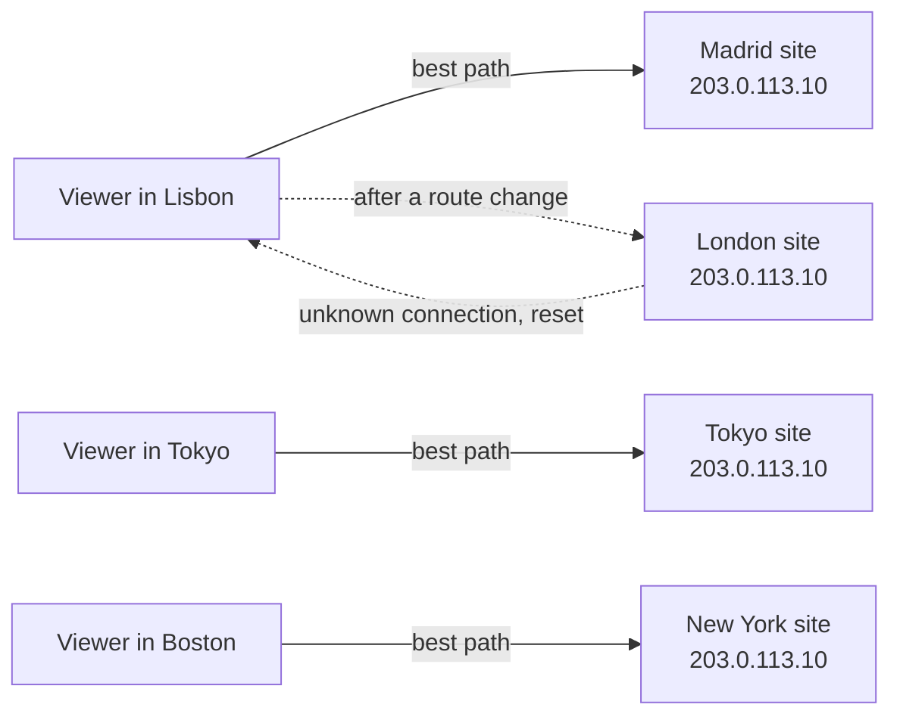

# Anycast

> Anycast puts the same IP address in many places at once, and internet routing sends each user to the closest one by network path. It powers DNS root servers, CDNs, and DDoS defense.

## How it works

Normally one IP address means one machine in one place. With anycast, servers in many cities share the same address, and every site announces it to the internet through BGP, the protocol networks use to tell each other which addresses they can reach.

Each router along the way sees several paths to that address and picks one based on its own policy, usually the path that crosses the fewest networks. So users land on the nearest site in network terms, not on a map. A user in Lisbon might reach Madrid, or London if their ISP hands traffic over there.

That one trick buys a lot:

- **Lower latency.** Users reach a nearby site with no DNS tricks. Google's `8.8.8.8` resolver works this way.
- **Automatic failover.** When a site fails, its announcement is withdrawn, and routers send its users to the next best site.
- **DDoS absorption.** A flood from a botnet spread around the world gets split across every site, and each one absorbs its local share. Cloudflare's network is built this way.
- **DNS roots.** The 13 root server names, A through M, are answered by more than 1,800 server instances sharing those addresses.

Anycast fits short, self contained requests best. A DNS lookup over UDP is one packet out and one back. If the next lookup lands on a different site, nobody cares.

The catch: routes change, and routers know nothing about your connections. If a route shifts in the middle of a long TCP session, the next packets arrive at a site that has never seen that connection, and it answers with a reset. Keep sessions short and retry cleanly, or use anycast only to find a site and then switch to that site's own address.

## Example

A video streaming site serves from 30 cities on one anycast address. A viewer in Lisbon lands in Madrid, 15 ms away, instead of the origin in Virginia, about 100 ms away. Each video segment is its own short HTTP request, so when routes move, a player at worst retries one 4 second segment.

Then the team adds offline downloads. The app pulls a 3 GB movie over one TCP connection that stays open for 20 minutes. One evening a big Portuguese ISP changes its routing, and its customers' packets start arriving in London. London has never seen those connections, so it resets them. Thousands of downloads die at 70 percent and start over from zero.

The fix is to download in 10 MB chunks with HTTP range requests. A reset now costs one chunk, and the app picks up where it left off.

```http
GET /downloads/movie-1832.mp4 HTTP/1.1
Range: bytes=10485760-20971519
```

## Picture it



Every site announces the same address, and each viewer's network picks the best path to one of them. The dotted arrows are the catch: after a route change, Lisbon's packets reach London, which knows nothing about the open connection and resets it.

## Related

[DNS](dns.md) · [CDN](../03-traffic/cdn.md) · [DDoS Protection](../17-web-security/ddos-protection.md) · [TCP vs UDP](tcp-vs-udp.md) · [Load Balancing](../03-traffic/load-balancing.md)
