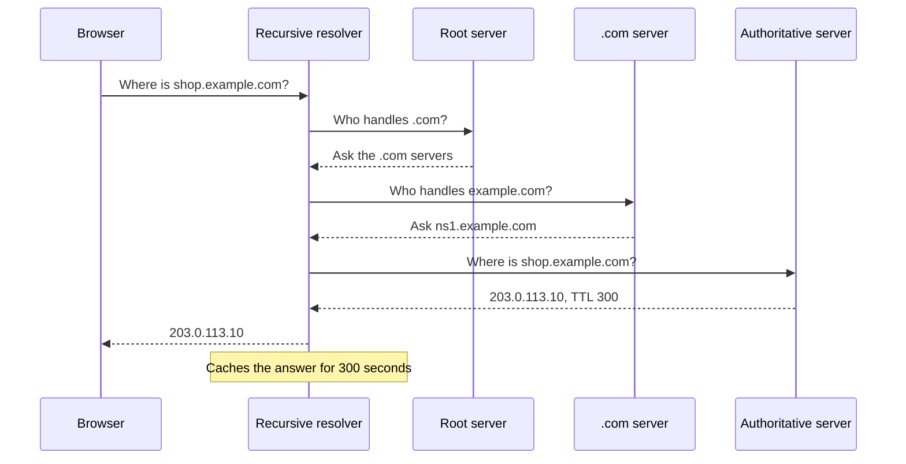

# DNS

> DNS is the internet's phone book. It turns a name like `shop.example.com` into an IP address your computer can connect to, and its caching is why a DNS change can take hours to reach everyone.



## How it works

Your browser wants `shop.example.com`. It checks its own cache, then the operating system's. On a miss, it asks a recursive resolver, usually run by your ISP or a public service like `1.1.1.1` or `8.8.8.8`. The resolver does the legwork:

1. **Root servers.** It asks a root server, which says "for `.com`, ask these servers".
2. **Top level domain servers.** The `.com` servers say "`example.com` is handled by these name servers".
3. **Authoritative servers.** Those hold the real answer: `shop.example.com` is `203.0.113.10`.

Every answer comes with a TTL, a time to live in seconds. The resolver and usually the operating system cache the answer until the TTL runs out. Browsers keep their own short copy, often for about a minute. That cache is why DNS is fast: most lookups never leave your machine or your ISP. It is also why changes are slow. If a record has a TTL of 86,400 (one day) and you change the IP, some users keep going to the old address for up to a day. A few resolvers hold answers even longer than they are told.

DNS can also route traffic. The authoritative server can hand out different IPs for the same name: the closest region, only healthy servers, or a weighted 90/10 split for a gradual rollout. AWS Route 53 and Cloudflare both offer this.

The catch: forgetting to lower the TTL before a migration. Drop it to 60 seconds at least one old TTL ahead of time, wait for the old cached copies to expire, then make the switch.

## Example

An online store is moving from an old data center to a cloud load balancer. The `A` record (the entry that maps a name to an IPv4 address) for `shop.example.com` points at `198.51.100.7` with a TTL of 86,400 seconds.

Bad plan: change the record Friday at 9 am. Resolvers that cached the old answer at 8:59 keep sending shoppers to the old servers until Saturday morning. Both sites have to stay up, and orders land in two places.

Better plan: on Thursday, drop the TTL to 60. Wait a full day, so every copy cached under the old one day TTL expires. On Friday, switch the record. Within a few minutes nearly all traffic is on the new IP. Once things look good, raise the TTL back to an hour.

```
shop.example.com.  60  IN  A  203.0.113.10
```

## Picture it



Only the first lookup walks the whole chain. After that, the resolver answers from cache until the TTL runs out, which is why a changed record takes a while to reach everyone.

## Related

[CDN](../03-traffic/cdn.md) · [Load Balancing](../03-traffic/load-balancing.md) · [Caching](../06-caching/caching.md) · [Failover](../21-disaster-recovery/failover.md) · [Multi Region Deployment](../21-disaster-recovery/multi-region-deployment.md)

---

[← Edge Caching](../03-traffic/edge-caching.md) · [All concepts](../../README.md) · [Anycast →](anycast.md)
