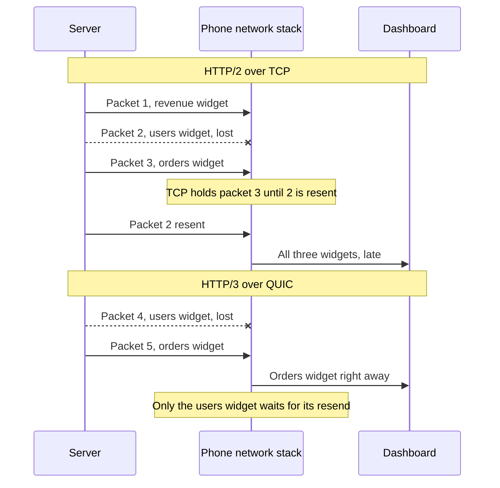

# Head of Line Blocking

> Head of line blocking is when one slow or lost item at the front of a line holds up everything behind it. On the web it shows up twice: once in HTTP/1.1, and again inside TCP.

## How it works

Think of one checkout lane where the first customer pays in coins. Everyone behind waits, even the person buying one banana. On the web, that happens at two layers:

- **HTTP/1.1 level.** A connection carries one request at a time, and the response must finish before the next request can use it. Browsers open up to 6 connections per hostname, which just means 6 lanes. A few slow responses clog all of them, and fast requests queue behind. Pipelining let clients send several requests without waiting, but responses still had to come back in order and buggy proxies mangled it, so browsers turned it off.
- **TCP level.** HTTP/2 fixes the first problem by mixing many requests as streams on one connection. But TCP promises to hand over bytes in order. If one packet is lost, TCP holds back every packet that arrived after it until the resend shows up, even packets for completely different streams. On a lossy network, every request on the connection stalls together.
- **HTTP/3 fix.** HTTP/3 runs on QUIC, which sits on UDP and keeps order per stream instead of per connection. A lost packet stalls only the stream it belongs to. The others keep flowing.

The same pattern shows up anywhere work waits in a single line, like a message queue where one stuck message blocks the rest of its partition.

The catch: HTTP/2 only fixes the HTTP layer. With heavy packet loss, one HTTP/2 connection can do worse than six HTTP/1.1 connections, because a single loss now freezes everything instead of one lane. Teams upgrade, see great numbers on office wifi, and never test on a bad phone connection.

## Example

A SaaS analytics dashboard loads 30 widgets, each with its own API call. Six of them are heavy reports that take 3 seconds. The other 24 take 50 ms.

On HTTP/1.1, the browser has 6 connections. The six slow reports grab all of them, and the 24 fast widgets wait 3 seconds for a free lane. Users stare at a blank dashboard.

The team moves to HTTP/2. All 30 calls go out at once on one connection, the fast widgets render in 200 ms, and the reports show up when ready. On office wifi, it's great.

Then a sales rep opens it on a train with 3% packet loss. Each lost packet freezes all 30 streams while TCP waits for the resend, and the whole dashboard stutters. Turning on HTTP/3 at the CDN fixes it: a lost packet now delays one widget, not all of them.

## Picture it

Over TCP, the orders widget's packet arrives fine but sits in the phone's buffer because an unrelated packet ahead of it was lost. Over QUIC, it goes straight to the dashboard.

## Related

[HTTP/2 and HTTP/3](http2-and-http3.md) · [TCP vs UDP](tcp-vs-udp.md) · [Latency](../01-performance/latency.md) · [Tail Latency](../01-performance/tail-latency.md) · [Message Queues](../13-messaging/message-queues.md)

---

[← HTTP/2 and HTTP/3](http2-and-http3.md) · [All concepts](../../README.md) · [Long Polling →](long-polling.md)
