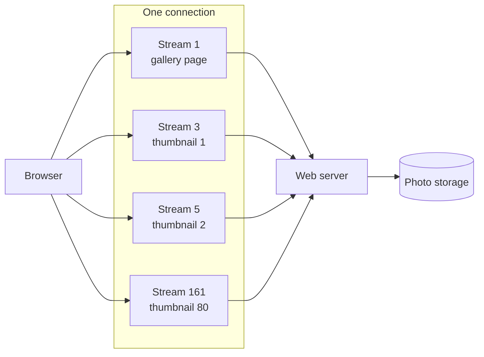

# HTTP/2 and HTTP/3

> HTTP/2 and HTTP/3 let one connection carry many requests at the same time, instead of one after another. Pages with dozens of files load faster, and HTTP/3 also copes better with flaky mobile networks.

## How it works

HTTP/1.1 handles one request per connection at a time. Browsers work around that by opening up to 6 connections per hostname, and requests still queue.

HTTP/2 (2015) keeps a single TCP connection and splits it into streams. Each request and response gets its own stream, chopped into small frames, and frames from different streams are mixed together on the wire. A hundred requests can be in flight on one connection, and a slow response no longer holds up the others at the HTTP level. Headers get compressed too, with a scheme called HPACK. Every request repeats the same cookies and user agent, so sending only what changed saves real bytes.

HTTP/3 (2022) keeps the streams but swaps the transport. Instead of TCP, it runs on QUIC, a protocol built on UDP:

- **Loss per stream.** QUIC tracks delivery per stream, so a lost packet stalls only the stream it belonged to. [Head of Line Blocking](head-of-line-blocking.md) has the full story.
- **Faster setup.** Encryption is built into the handshake, so a new connection is ready after one round trip instead of two or three for TCP plus TLS.
- **Survives network changes.** A connection is identified by an ID, not your IP address, so it can keep going when a phone hops from wifi to cellular, if the server supports it.

Browsers usually learn that a server speaks HTTP/3 from an `Alt-Svc` response header, and fall back to HTTP/2 when a network blocks UDP. You need both working.

Watch out: HTTP/1.1 era tricks now backfire. Spreading images across `img1` and `img2` subdomains (called domain sharding) forces extra connections and throws away the point of multiplexing.

## Example

A photo sharing app's gallery page loads 80 thumbnails of about 20 KB each. Over HTTP/1.1, the browser opens 6 connections and fetches 6 at a time, so the last thumbnails wait through about 14 rounds. With 100 ms round trips, that is over a second of mostly waiting.

Over HTTP/2, the browser sends all 80 requests at once on one connection, and the server streams them back as they are ready. The page fills in about as fast as the bandwidth allows.

On a phone on a train, HTTP/3 helps more. A lost packet stalls only the thumbnail it belonged to, and when the phone switches from station wifi to 5G, the connection can carry on instead of starting over.

```http
HTTP/2 200
content-type: image/webp
alt-svc: h3=":443"; ma=86400
```

## Picture it



Every file travels as its own stream inside a single connection, so the thumbnails load side by side instead of waiting in line for one of 6 connections. HTTP/2 carries the streams over TCP, HTTP/3 over QUIC.

## Related

[Head of Line Blocking](head-of-line-blocking.md) · [TCP vs UDP](tcp-vs-udp.md) · [TLS](../16-identity-and-encryption/tls.md) · [gRPC](../05-apis/grpc.md) · [Latency](../01-performance/latency.md)
