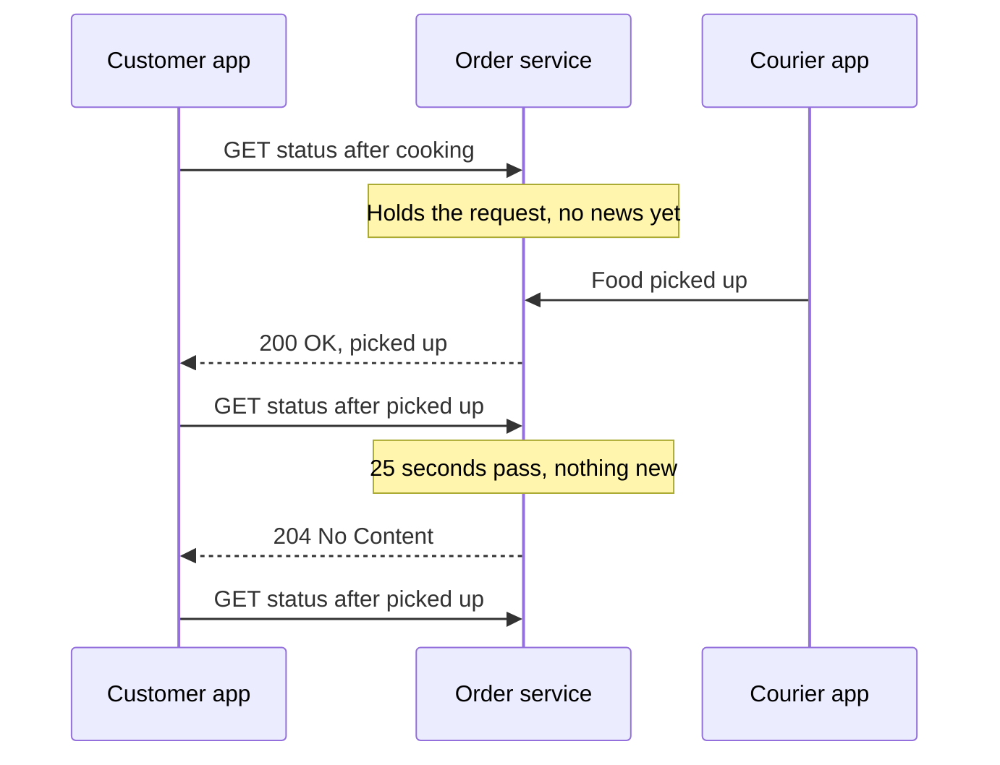

# Long Polling

> Long polling fakes server push with plain HTTP. The client asks "anything new?" and the server holds the request open until it has news or a timeout hits, then the client asks again.

## How it works

Regular polling asks every few seconds. Most answers are "no", so you burn requests and still see updates up to one interval late.

Long polling changes the timing. The client sends a request, and the server does not answer right away. It parks the request until something happens, then responds with the update. The client handles it and immediately sends the next request. If nothing happens for, say, 25 seconds, the server returns an empty response and the client asks again.

Each request carries a cursor, like the ID of the last event the client saw. Anything that happens in the gap between one response and the next request is waiting there when the client comes back.

- **Why pick it.** It is ordinary HTTP. It works through every proxy, firewall, and old browser, with no special server or load balancer support.
- **Cost.** Every update costs a full request with headers, and the server holds one open request per waiting client. Use an async server, or a thread per request design runs out of threads.
- **Speed.** A single update arrives almost instantly. A burst is slower, since every event after the first waits for a new round trip.

Next to Server Sent Events and WebSockets, it is the oldest and most compatible option, and the least efficient.

The catch: timeouts along the path. If your load balancer cuts idle requests at 30 seconds and your server holds them for 60, every client gets an error, reconnects at once, and you get a storm. Keep the server's hold time below every timeout in front of it.

## Example

A food delivery app shows order status: confirmed, cooking, picked up, arriving. That is 4 or 5 updates over 40 minutes.

Polling every 5 seconds means 480 requests per order, and nearly all of them return "no change". With 50,000 active orders, that is 10,000 requests a second of mostly nothing.

With long polling, each open app sends `GET /orders/881/status?after=cooking`. The server holds it for up to 25 seconds. When the courier picks up the food, the server answers right away and the app asks again. Each order now costs about one request every 25 seconds, roughly 2,000 requests a second across all orders, and updates show up in under a second instead of up to 5 seconds late.

## Picture it

The server sits on each request until there is news. When the courier picks up the food, the waiting request is answered at once. When nothing happens, the timeout sends back an empty answer and the app simply asks again.

## Related

[Server Sent Events](server-sent-events.md) · [WebSockets](websockets.md) · [Timeouts](../14-reliability/timeouts.md) · [Load Balancing](../03-traffic/load-balancing.md)
