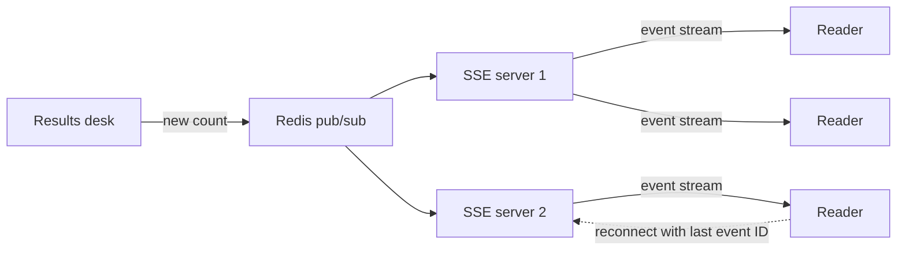

# Server Sent Events

> Server Sent Events keep one HTTP response open so the server can push a stream of text updates to the browser. It is the simplest way to send live updates one way, from server to client.



## How it works

The browser makes a normal HTTP request. The server answers with `Content-Type: text/event-stream` and never finishes the response. Whenever there is news, it writes a few lines of text, and the browser fires an event in your code. On the client, that is `new EventSource("/live")` plus a message handler.

- **Plain HTTP.** It works with cookie logins, load balancers, and HTTP/2. No new protocol to support. The browser's `EventSource` can't add an `Authorization` header, though.
- **Automatic reconnect.** If the connection drops, the browser reconnects by itself after a few seconds and, if events carry an ID, sends a `Last-Event-ID` header, so the server can replay what was missed.
- **One way only.** The server talks, the client listens. To send something back, the client makes a normal HTTP request.
- **Text only.** Events are plain text. Most apps send JSON, and binary data has to be encoded first, as base64 for example.

Compared with WebSockets, SSE gives up the client to server direction in exchange for being plain HTTP. That trade is usually worth it. Scores, notifications, progress bars, and dashboards only need the server to talk. Many AI chat APIs stream their replies token by token over SSE for the same reason.

The catch: over HTTP/1.1, browsers allow only 6 connections per hostname, and each open SSE stream holds one. Open the page in 7 tabs and the 7th hangs. Serve it over HTTP/2, where streams share one connection, and the limit usually rises to 100 or more. Also watch for proxies that buffer responses, because they will hold your events back until the buffer fills. Turn buffering off for the stream route.

## Example

A news site runs a live election page. Results arrive every few seconds, 200,000 readers have the page open, and readers never send anything back.

Polling every 5 seconds would be 40,000 requests a second, mostly returning the same numbers. With SSE, each browser holds one open stream. When a county reports, the results desk publishes one message, and every SSE server writes a small event into each of its open streams.

```
id: 1042
event: result
data: {"county": "Kent", "reported": 87}
```

When a reader's phone switches networks, the browser reconnects with `Last-Event-ID: 1042` and the server replays everything after event 1042. The team built it on their existing web servers and load balancer.

## Picture it



Each reader holds one open response from an SSE server. A new count fans out through pub/sub to every server, which writes it into all its open streams. A reader who drops reconnects and picks up where it left off.

## Related

[WebSockets](websockets.md) · [Long Polling](long-polling.md) · [HTTP/2 and HTTP/3](http2-and-http3.md) · [Pub/Sub](../13-messaging/pub-sub.md) · [Fan Out](../13-messaging/fan-out.md)

---

[← Long Polling](long-polling.md) · [All concepts](../../README.md) · [WebSockets →](websockets.md)
