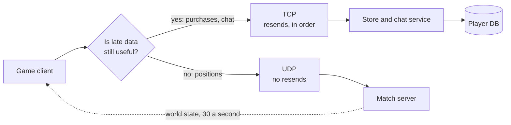

# TCP vs UDP

> TCP and UDP are the two main ways to move data across the internet. TCP guarantees every byte arrives, in order, while UDP fires packets and hopes, which makes it faster when late data is useless anyway.

## How it works

TCP starts with a handshake, three messages back and forth before any data moves. After that, every byte gets a sequence number. The receiver confirms what it got, the sender resends what went missing, and your app reads the bytes in exactly the order they were sent. TCP also slows down when the network looks congested. Most web pages, APIs, and database connections ride on TCP.

UDP skips all of that. No handshake, no confirmations, no resends, no ordering. Each packet is on its own. If it gets lost, nobody notices unless your app does.

| | TCP | UDP |
|---|---|---|
| Setup | Handshake first | None, just send |
| Lost packets | Resent automatically | Gone |
| Order | Guaranteed | Not guaranteed |
| Good for | APIs, file transfers, payments | Games, voice and video calls, DNS lookups |

TCP's guarantees cost time. When a packet is lost, everything behind it waits for the resend. For a file download, fine. For a voice call, audio from 300 ms ago is worse than no audio, so UDP lets the app skip the gap and move on.

UDP is also the base for newer protocols that want their own rules. QUIC, the transport under HTTP/3, runs on UDP and adds reliability per stream on top.

The catch: with UDP, any reliability you need is yours to build. Teams pick it for speed, then slowly rebuild half of TCP, badly. Some corporate networks also block UDP, so you need a TCP fallback.

## Example

A multiplayer shooter sends each player's position 30 times a second. Over TCP, one lost packet on a shaky connection makes every packet behind it wait until the resend arrives. On a connection with 150 ms round trips, players see everyone freeze, then jump.

Over UDP, a lost position update is simply skipped. The next one arrives 33 ms later with fresher data anyway, and the game smooths over the gap by guessing where each player is heading.

The same game still uses TCP for things that must arrive: buying an item, chat messages, the final score. Most real games mix both, and many add a thin reliable layer on top of UDP for the few messages that matter.

## Picture it

Purchases and chat must arrive, so they go over TCP. Position updates are stale after 33 ms, so they go over UDP, and a lost one is simply replaced by the next.

## Related

[HTTP/2 and HTTP/3](http2-and-http3.md) · [Head of Line Blocking](head-of-line-blocking.md) · [WebSockets](websockets.md) · [Latency](../01-performance/latency.md) · [TLS](../16-identity-and-encryption/tls.md)
