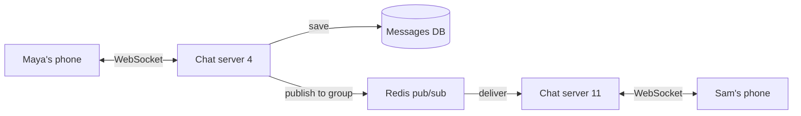

# WebSockets

> A WebSocket is one long lived connection where the client and the server can both send messages at any moment. It is the standard choice for chat, multiplayer games, and live collaboration.

## How it works

It starts as a normal HTTP/1.1 request with an `Upgrade: websocket` header. The server replies `101 Switching Protocols`, and from then on the same TCP connection stops speaking HTTP. Both sides send small framed messages, text or binary, whenever they like, with only a few bytes of overhead each. Unlike long polling or Server Sent Events, traffic flows both ways with no headers per message.

The price is that every connection is state living on one specific server. That changes how you run things:

- **Scaling out.** User A is connected to server 1 and user B to server 3. To get A's message to B, servers need a shared channel, usually Redis pub/sub or a message broker.
- **Load balancers.** They must support the upgrade and allow connections that stay open for hours, not 60 second requests.
- **Deploys.** Restarting a server drops thousands of connections at once. Drain them gradually, or every client reconnects in the same second.
- **Heartbeats.** Send a small ping every 30 seconds or so. Otherwise dead connections linger on the server, and idle ones get cut by proxies.

The catch: WebSockets give you a pipe, nothing more. There is no automatic reconnect, no replay, and no delivery guarantee. When the connection drops, messages sent during the gap are gone unless you build resume logic yourself: an ID on every message, a "send me everything after 1042" request on reconnect, and clients that reconnect with backoff and random delay so they don't all return at once.

## Example

A chat app has 400,000 users online across 20 WebSocket servers, about 20,000 connections each. Maya, on server 4, sends "running late" to a group that includes Sam, who is on server 11.

Server 4 saves the message to the database, then publishes it to the group's channel in Redis. Server 11 is subscribed to that channel because Sam is connected to it, so it pushes the message down Sam's socket. Sam sees it about 50 ms after Maya hits send. Typing indicators flow the same way, several times a second, and that constant two way chatter is exactly what WebSockets are good at.

When server 11 is redeployed, Sam's app reconnects to another server and asks for every message after the last ID it saw, so nothing is lost.

## Picture it

Each phone holds an open socket to one server. Maya's message reaches Sam only because server 4 publishes it to Redis, and server 11, which holds Sam's socket, picks it up and pushes it down.

## Related

[Server Sent Events](server-sent-events.md) · [Long Polling](long-polling.md) · [Pub/Sub](../13-messaging/pub-sub.md) · [Sticky Sessions](../02-scaling/sticky-sessions.md) · [Heartbeats](../10-distributed-systems/heartbeats.md)

---

[← Server Sent Events](server-sent-events.md) · [All concepts](../../README.md) · [REST →](../05-apis/rest.md)
