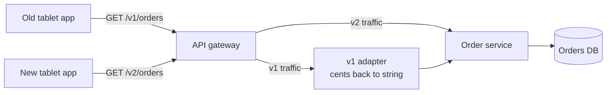

# API Versioning

> API versioning lets you change an API without breaking the apps already using it. Old clients keep the old behavior, new clients opt into the new one, and the old version retires on a schedule.

## How it works

First, sort every change into breaking or not.

| Change | Breaking? |
|---|---|
| Add an endpoint | No |
| Add a field to a response | No |
| Add an optional request field | No |
| Remove or rename a field | Yes |
| Change a type, like price from string to integer | Yes |
| Make an optional field required | Yes |

Non breaking changes ship any day. Breaking changes need a new version, and there are two common places to put it.

**In the URL**, like `/v1/orders` and `/v2/orders`. Obvious, easy to route, easy to test in a browser, easy to spot in logs. Most public APIs do this.

**In a header**, like `Accept: application/vnd.shop.v2+json`. URLs stay clean, but the version is easy to miss and harder to test by hand. Stripe uses dated versions in a `Stripe-Version` header and pins each account to the version it started on.

Either way, keep one codebase. Translate old requests and responses in a thin layer at the edge instead of running two copies of the app.

Every live version is code you test and support, so retire old ones. Announce a date, add `Deprecation` and `Sunset` headers to old responses, use your logs to find who still calls the old version, and contact them before you switch it off.

The catch: changes you didn't think were breaking. Adding a new value to a field, like a new order status `"refunded"`, can crash every client whose code only expects the old values. Tell clients from day one to tolerate unknown fields and values, and announce new ones anyway.

## Example

A food delivery app has a partner API that 1,200 restaurants' tablet systems call to fetch orders. In `v1`, `total` is a string, `"24.90"`. The team wants integer cents to stop rounding bugs.

Changing `v1` in place would break every restaurant overnight. Instead they ship `/v2/orders` with `total_cents: 2490`. Both versions read the same order service, and a small adapter converts responses back to the old format for `v1`.

Then the deprecation plan. They announce a 12 month sunset, add a `Sunset` header to every `v1` response, and check the logs monthly. Eleven months in, 40 restaurants still call `v1`, so the partner team phones each one. On the sunset date, `v1` returns `410 Gone` with a link to the migration guide.

## Picture it

Both versions end up at the same order service. The v1 path just passes through a small adapter that turns cents back into the old string format, so there is one codebase to maintain, not two.

## Related

[Semantic Versioning](../19-build-and-infra/semantic-versioning.md) · [REST](rest.md) · [Schema Versioning](../07-databases/schema-versioning.md) · [Serialization Formats](serialization-formats.md) · [Hyrum's Law](../23-laws/hyrums-law.md)

---

[← Pagination](pagination.md) · [All concepts](../../README.md) · [Serialization Formats →](serialization-formats.md)
