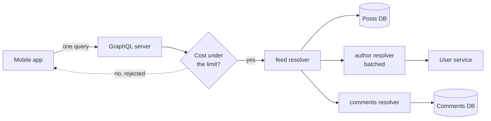

# GraphQL

> GraphQL lets the client ask for exactly the fields it needs, across related data, in one request. You trade simple URLs and easy caching for flexibility, plus a server that has to defend itself from expensive queries.

## How it works

A GraphQL API has one endpoint, usually `POST /graphql`, and a schema: a typed list of everything clients can ask for. A `User` has a `name` and `posts`, a `Post` has an `author` and `comments`, and so on. The client sends a query shaped like the answer it wants and gets JSON back in exactly that shape. No extra fields, no chain of round trips.

On the server, each field has a resolver, a small function that fetches it. The `posts` resolver loads a user's posts, and the `author` resolver loads each post's author. Writes go through mutations. Facebook built GraphQL for its mobile apps and open sourced it in 2015.

The pain comes from that same flexibility:

- **Expensive queries.** A client can nest `friends { friends { friends { posts } } }` and ask for millions of rows in one request. Cap query depth, score each query's cost and reject heavy ones, or only accept a list of approved queries.
- **N+1 queries.** Loading 50 posts and then each author one at a time means 51 database calls. Batch them with a tool like DataLoader.
- **Caching.** Every request is a `POST` to the same URL, so CDNs and browsers can't cache by URL the way they do with REST. You rely on client caches like Apollo, or on persisted queries sent as a `GET` with a query ID.

The catch: rate limiting by request count stops making sense. One GraphQL request can cost 1 ms or 30 seconds. Limit by query cost instead. GitHub's GraphQL API does this, charging each query points based on how many lists it might have to fetch.

## Example

A social feed's home screen shows 20 posts, each with the author's name and avatar and the first 2 comments. Over REST that was 1 call for the feed, 20 for authors, and 20 for comments, or a pile of custom endpoints.

With GraphQL, the app sends one query:

```graphql
query {
  feed(first: 20) {
    text
    author { name avatarUrl }
    comments(first: 2) { text }
  }
}
```

The answer comes back in the same shape, about 12 KB. The web team later adds like counts to its version of the screen without touching the server.

Then someone scripts a query for `feed(first: 500)` with 500 comments per post. That is 250,000 rows. The server's cost check scores it at 250,000 points against a limit of 10,000 and rejects it before a single resolver runs.

## Picture it



The app sends one query. The server checks its cost first, then each resolver fetches its own piece from the right place, and the pieces are stitched into one response shaped like the query.

## Related

[REST](rest.md) · [gRPC](grpc.md) · [N+1 Queries](../07-databases/n-plus-one-queries.md) · [Rate Limiting](../03-traffic/rate-limiting.md) · [Caching](../06-caching/caching.md)

---

[← REST](rest.md) · [All concepts](../../README.md) · [gRPC →](grpc.md)
