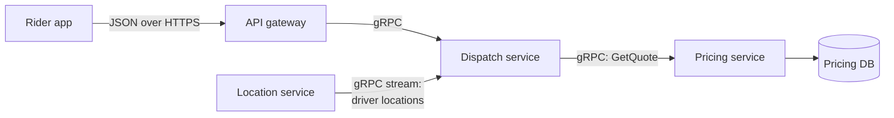

# gRPC

> gRPC lets one service call a function on another service as if it were local, sending compact binary messages over HTTP/2. It is fast, strictly typed, and a favorite for traffic between your own backend services.

## How it works

You describe your API in a `.proto` file: the services, their methods, and the exact shape of every message. A code generator turns that file into client and server code for Go, Java, Python, C++, and more. Calling another service then looks like calling a function, `pricing.GetQuote(request)`, and the generated code handles the network.

Under the hood, messages are encoded with Protocol Buffers, a binary format that is much smaller and faster to parse than JSON. Calls run over HTTP/2, so many calls share one long lived connection.

There are four call styles:

- **Unary.** One request, one response, like a normal API call.
- **Server streaming.** One request, many responses, like a live feed of driver locations.
- **Client streaming.** Many requests, then one response, like uploading a batch of sensor readings.
- **Bidirectional streaming.** Both sides stream at the same time over one call.

Google based it on Stubby, the system its own services used to call each other, and open sourced it in 2015.

The catch: browsers can't speak gRPC directly. They don't give JavaScript the low level control over HTTP/2 that gRPC needs. You need `gRPC-Web` plus a proxy like Envoy, or a gateway that translates gRPC to JSON. That is why most teams use gRPC inside the backend and REST or GraphQL at the edge. Debugging is harder too, because you can't read binary payloads with `curl`. Tools like `grpcurl` help.

## Example

In a ride sharing app, the dispatch service asks the pricing service for a quote every time it considers matching a rider with a driver. At rush hour, that is 8,000 calls a second.

The first version used JSON over HTTP/1.1. Each quote request and reply came to about 1.2 KB, and a renamed field once broke dispatch in production because nothing checked the contract.

After moving that link to gRPC, the same request and reply take about 300 bytes. Both services generate code from one `pricing.proto`, so a type mismatch now fails the build instead of failing on a Friday evening. Calls share a few HTTP/2 connections instead of opening new ones. The rider app still sends JSON to the API gateway, which translates.

```proto
service Pricing {
  rpc GetQuote (QuoteRequest) returns (Quote);
}
message QuoteRequest {
  string rider_id = 1;
  double pickup_lat = 2;
  double pickup_lng = 3;
  // more fields in the real message
}
```

## Picture it



Outside clients speak JSON to the gateway. Behind it, services call each other with gRPC, including a long running stream that pushes driver locations to dispatch as they change.

## Related

[Serialization Formats](serialization-formats.md) · [REST](rest.md) · [HTTP/2 and HTTP/3](../04-networking/http2-and-http3.md) · [API Gateways](../03-traffic/api-gateways.md) · [Service Mesh](../15-architecture/service-mesh.md)

---

[← GraphQL](graphql.md) · [All concepts](../../README.md) · [Webhooks →](webhooks.md)
