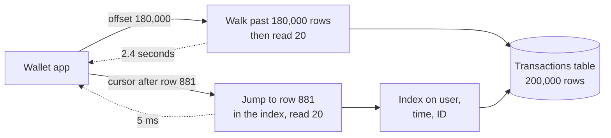

# Pagination

> Pagination splits a big list into pages so an API never returns a million rows at once. Offset pagination is simple but slows down and skips rows on big, changing tables, while cursor pagination stays fast and stable.

## How it works

**Offset pagination** says "give me 20 rows, skipping the first 40": `?limit=20&offset=40`. Easy to build, and users can jump straight to page 50.

It has two problems. First, ask for offset 40,000 and the database can't jump there. It walks past every skipped row and throws it away, so page 2,001, the one at that offset, is far slower than page 1. Second, the list moves while you page through it. If 3 new rows land at the top while you read page 1, page 2 starts with 3 rows you already saw. Delete a row and you silently skip one.

**Cursor pagination**, also called keyset pagination, says "give me 20 rows after this one". The cursor holds the sort key of the last row you saw, like its timestamp and ID, packed into a string the client treats as a black box. The query becomes `WHERE (created_at, id) < (:t, :id) ORDER BY created_at DESC, id DESC LIMIT 20`. With an index on those columns, the database goes straight to that spot. Page 2,000 is as fast as page 1, and new rows at the top shift nothing.

The tradeoff: no jumping to page 50, and no "page 7 of 312" without a separate count query. For feeds, logs, and public APIs, nobody misses that. For a small admin table with page numbers, offset is fine.

The catch: a cursor on a column that isn't unique. Page by `created_at` alone, and when 30 rows share the same second, some fall through the crack between pages. Always add a tiebreaker like the ID.

## Example

A wallet app shows transaction history, and heavy users have 200,000 transactions. The first version used `OFFSET`. Deep in history, a request for offset 180,000 took 2.4 seconds, because Postgres read and threw away 180,000 rows to return 20.

Worse, a payment arriving mid scroll pushed every row down by one, so users saw the same transaction twice at a page boundary and filed tickets about double charges.

The team switched to cursors. Each response includes `next_cursor`, which encodes the last row's timestamp and ID. The next request asks for rows older than that, using an index on `(user_id, created_at, id)`. Every page now takes about 5 ms, no matter how deep, and new payments at the top no longer shift anything.

```http
GET /wallet/transactions?limit=20&cursor=eyJ0IjoxNzQ5ODkzNDEyLCJpZCI6ODgxfQ
```

## Picture it



Both requests want the same 20 rows. The offset query walks past 180,000 rows to find them. The cursor query uses the index to land on the right spot directly, so its speed doesn't depend on how deep you are.

## Related

[Database Indexing](../07-databases/database-indexing.md) · [Query Optimization](../07-databases/query-optimization.md) · [REST](rest.md) · [GraphQL](graphql.md)

---

[← Webhooks](webhooks.md) · [All concepts](../../README.md) · [API Versioning →](api-versioning.md)
