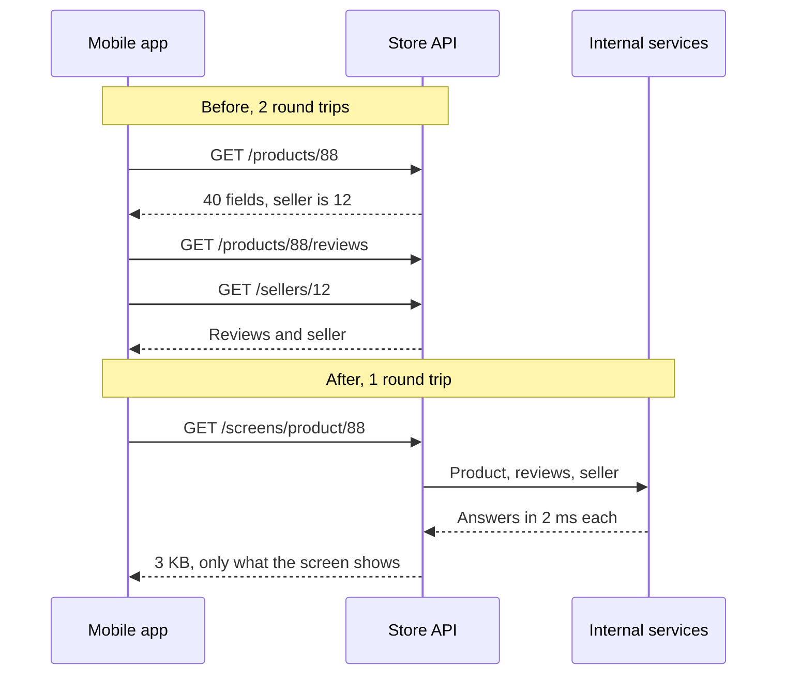

# REST

> REST is the most common way to design a web API. Everything is a resource with its own URL, and you act on it with standard HTTP methods like GET, POST, and DELETE.

## How it works

A REST API is organized around nouns. `/users/42` is a user, and `/users/42/orders` is that user's orders. HTTP methods are the verbs:

| Request | Meaning | Safe to repeat? |
|---|---|---|
| `GET /orders/7` | Read it | Yes |
| `POST /orders` | Create a new one | No |
| `PUT /orders/7` | Replace it | Yes |
| `PATCH /orders/7` | Change some fields | Depends |
| `DELETE /orders/7` | Remove it | Yes |

Status codes report the result: `200` OK, `201` created, `404` not found, `409` conflict, `500` the server broke.

Each request carries everything the server needs, including auth. The server keeps no memory of the client between requests, so any server behind the load balancer can answer. And because `GET` means read only, browsers, CDNs, and proxies can cache responses with standard headers like `Cache-Control` and `ETag`. Every language, tool, and developer already knows how this works.

The classic pain is that the server decides the shape of each response. Over fetching: the mobile app needs a product's name and price, and gets 40 fields in a 30 KB response. Under fetching: one screen needs a product, its reviews, and its seller, which means 3 calls, often one after another. Common fixes are a `?fields=name,price` parameter, an endpoint built for one screen, or GraphQL for that part of the app.

The catch: verbs hiding in URLs. `POST /getUser` or `POST /orders/7/delete` throws away caching, retry safety, and every tool's assumptions. If it only reads, make it a `GET`.

## Example

An online store's mobile product page shows the product, its top 3 reviews, and the seller's rating. The REST API has a clean endpoint for each.

The app calls `GET /products/88` and waits for the reply to learn the seller ID. Then it calls `/products/88/reviews` and `/sellers/12` in parallel. On a phone with 150 ms round trips, that is 300 ms of waiting before the page is complete. The product response alone ships 40 fields and 30 KB, and the screen shows 4 of them.

The team adds `GET /screens/product/88`, an endpoint shaped for that one screen. It gathers all three pieces on the server, where calls between services take 2 ms, and returns 3 KB. The page now loads in one round trip. The general endpoints stay for partners and the website.

## Picture it

Before, the app pays a full phone round trip just to learn the seller ID, then another for the rest. After, the server does the gathering over its fast internal network and sends back one small reply.

## Related

[GraphQL](graphql.md) · [gRPC](grpc.md) · [Pagination](pagination.md) · [API Versioning](api-versioning.md) · [Idempotency](../14-reliability/idempotency.md)

---

[← WebSockets](../04-networking/websockets.md) · [All concepts](../../README.md) · [GraphQL →](graphql.md)
