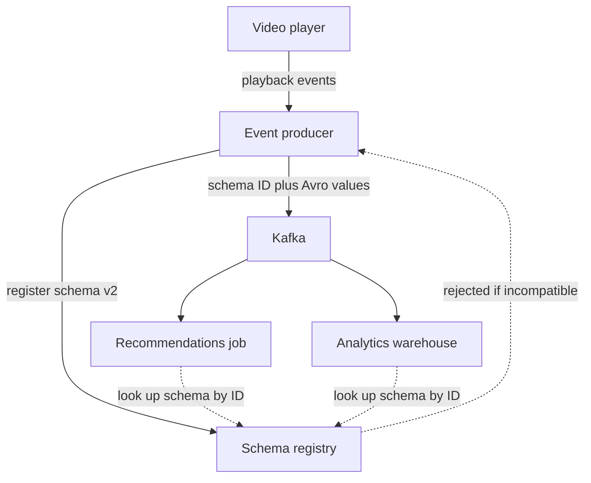

# Serialization Formats

> Serialization turns the objects in your program into bytes you can send or store. JSON is readable and works everywhere, while binary formats like Protobuf and Avro are smaller, faster, and come with schemas that make change safer.

## How it works

Every time a service sends a message or writes a record, it turns its data into bytes, and the reader turns them back. The format decides how big those bytes are, how fast they parse, and what happens when the shape of the data changes.

| | JSON | Protobuf | Avro |
|---|---|---|---|
| Looks like | Readable text | Binary | Binary |
| Schema | None required | A `.proto` file | A schema written in JSON, kept with the data or in a registry |
| Field names in each message | Yes, every time | No, small field numbers | No, the reader has the schema |
| Typical use | Public APIs, config | gRPC, service to service calls | Kafka, data pipelines |

JSON repeats every field name in every message and writes numbers as text. Protobuf swaps names for small field numbers, so `{"user_id": 123456}` (19 bytes) becomes 4 bytes. Smaller messages mean less bandwidth, less storage, and faster parsing.

The bigger reason to pick a schema format is safe change, called schema evolution. Producers and consumers deploy at different times, so old code will read new data and new code will read old data. In Protobuf, you add fields with new numbers, and old readers skip numbers they don't know. In Avro, the reader compares the writer's schema with its own, and new fields need a default value. A schema registry can check that every new schema is compatible before anyone uses it.

The catch: deleting a Protobuf field and later reusing its number for something else. Old messages still carry the old meaning, and new code decodes them as the new field. Mark removed numbers as `reserved` so nobody can reuse them.

## Example

A video streaming site logs a playback event every 10 seconds per viewer: user, video, position, bitrate, device. At peak, that is 500,000 events a second into Kafka.

As JSON, each event is about 300 bytes, mostly repeated field names. That is 150 MB a second, roughly 13 TB a day before replication. With Avro and a schema registry, each event carries a 5 byte header pointing at its schema, then only the values, about 60 bytes in total. The pipeline drops to about 2.6 TB a day, and consumers parse faster.

Later, the player team adds a `buffering_ms` field with a default of 0. The registry accepts it, since old and new consumers can both still read every event. When someone tries to change `position` from an integer to a string, the registry rejects the schema before a single bad event is written.

## Picture it

Producers register each schema version before using it, and the registry blocks changes that would break readers. Each message carries only a schema ID and the values, and consumers fetch the schema by ID to decode it.

## Related

[gRPC](grpc.md) · [API Versioning](api-versioning.md) · [Schema Versioning](../07-databases/schema-versioning.md) · [Event Streaming](../13-messaging/event-streaming.md) · [Postel's Law](../23-laws/postels-law.md)

---

[← API Versioning](api-versioning.md) · [All concepts](../../README.md) · [Caching →](../06-caching/caching.md)
