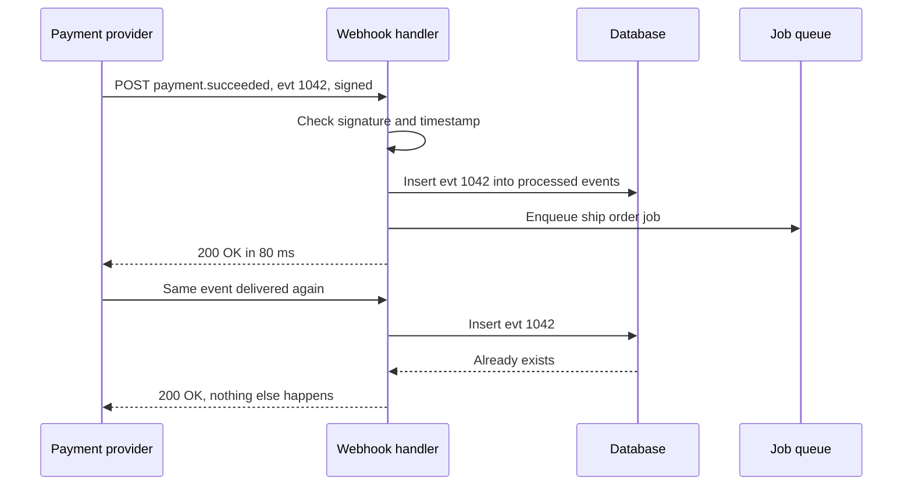

# Webhooks

> A webhook is an HTTP request another service sends to your server when something happens, like "payment succeeded". Instead of you asking over and over, they call you, so you have to verify, dedupe, and answer fast.

## How it works

You give the provider a URL, say `https://shop.example.com/hooks/payments`, and pick the events you care about. When one happens, the provider sends a `POST` with a JSON body describing it. You reply with a `2xx` status to say "got it".

Three things make it safe:

- **Signing.** Anyone on the internet can POST to your URL. So the provider signs each payload with a secret that only the two of you know, usually an HMAC (a hash of the body mixed with the secret), and puts it in a header. You recompute it and reject mismatches. A timestamp inside the signed data lets you reject old requests, so a captured one can't be replayed next week.
- **Retries.** If your server is down, slow, or returns an error, most providers try again with growing gaps, often for hours or days. In live mode, Stripe keeps retrying for up to 3 days.
- **Idempotency.** Retries mean the same event can arrive twice, and events can arrive out of order. Store each event ID and skip the ones you have already handled.

Answer fast. Providers wait only a few seconds. If your handler spends 20 seconds sending emails and updating 3 tables, the provider gives up and retries while the first attempt is still running. Save the event, return `200`, and do the real work from a queue.

Watch out: webhooks are not a complete record. If your endpoint is broken longer than the retry window, events are gone for good. Run a periodic job that asks the provider's API for recent events and fills any gaps.

## Example

An online store takes payments through a payments API. When a charge succeeds, the provider sends `payment.succeeded` to the store's webhook URL.

One evening, the handler takes 20 seconds because it builds a PDF invoice inline. The provider gives up after 10 seconds and retries. The first attempt finishes anyway, so the order ships twice and the customer gets two invoices.

The fix has three parts. Check the signature first. Insert the event ID into a `processed_events` table with a unique constraint, and stop if the insert fails. Then queue the work and return `200` in under 100 ms. A duplicate now hits a fast no op, and the invoice gets built once, in the background.

```http
POST /hooks/payments HTTP/1.1
webhook-id: evt_1042
webhook-timestamp: 1750000000
webhook-signature: v1,3q2+7wQx9rTnLm4Vb8sKfJ0hYc6ZpE1aWdUoGiR5vNk=
```

## Picture it



The handler checks the signature, records the event ID, queues the real work, and answers fast. When the same event shows up again, the insert fails on the unique ID, so the order ships only once.

## Related

[Idempotency](../14-reliability/idempotency.md) · [Retries](../14-reliability/retries.md) · [Exponential Backoff](../14-reliability/exponential-backoff.md) · [Message Queues](../13-messaging/message-queues.md) · [Delivery Guarantees](../13-messaging/delivery-guarantees.md)
