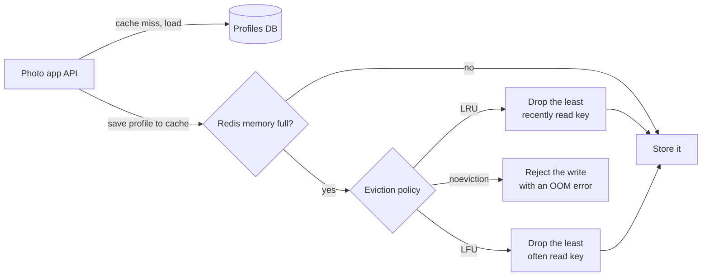

# Cache Eviction

> A cache has limited memory, so when it fills up, something has to go. The eviction policy decides what gets thrown out, and a good one keeps the data people actually ask for.

## How it works

The common policies:

- **LRU, least recently used.** Throw out whatever has gone longest without being read. The most common choice, because something used a minute ago is likely to be used again soon.
- **LFU, least frequently used.** Throw out what gets read least often. Better when some keys are steadily popular, since a burst of new keys read once can't push them out.
- **FIFO, first in, first out.** Throw out the oldest entry, no matter how popular. Simple and cheap, and it will happily evict your hottest key.
- **TTL.** Each entry expires after a set time, like 10 minutes. This is about freshness more than memory, but expired keys free up space too.

Real caches approximate these. Redis doesn't track exact LRU order for every key. It samples 5 keys by default and evicts the best candidate among them, which is close enough and much cheaper.

What happens when memory fills up depends on your settings. In Redis you set a `maxmemory` limit and a policy. With `allkeys-lru` or `allkeys-lfu`, any key can be evicted. The `volatile` versions only evict keys that have a TTL. The default policy, `noeviction`, evicts nothing: once memory is full, writes fail with an error while reads keep working.

The catch: running Redis as a cache with that default. It works fine until the first busy week fills memory, then every write fails with an `OOM` error. For a cache, pick an `allkeys` policy, and watch the eviction count. Constant evictions mean the cache is too small for its working set.

## Example

A photo sharing app caches user profiles in a 16 GB Redis with LRU. The 200,000 or so profiles that active users look at fit easily, and the hit ratio is 97%.

Every night at 2 am, an analytics job reads all 20 million profiles once, through the same cache. Under LRU, each of those reads counts as recent, so the job pushes out the profiles active users need. By 7 am the cache is full of profiles nobody wants, the hit ratio is down to 40%, and the database takes the morning rush cold.

Two fixes. Switch to `allkeys-lfu`, so a key read once at 2 am can't beat a key read 500 times an hour. Better still, point the batch job at a read replica so it skips the cache entirely.

## Picture it

Eviction only kicks in when a new key arrives and memory is full. The policy picks a victim, or with Redis's default, refuses the write. Which victim it picks decides your hit ratio.

## Related

[Caching](caching.md) · [Caching Strategies](caching-strategies.md) · [Cache Invalidation](cache-invalidation.md) · [Read Replicas](../09-data-at-scale/read-replicas.md) · [Memory Leaks](../12-concurrency/memory-leaks.md)

---

[← Caching Strategies](caching-strategies.md) · [All concepts](../../README.md) · [Cache Invalidation →](cache-invalidation.md)
