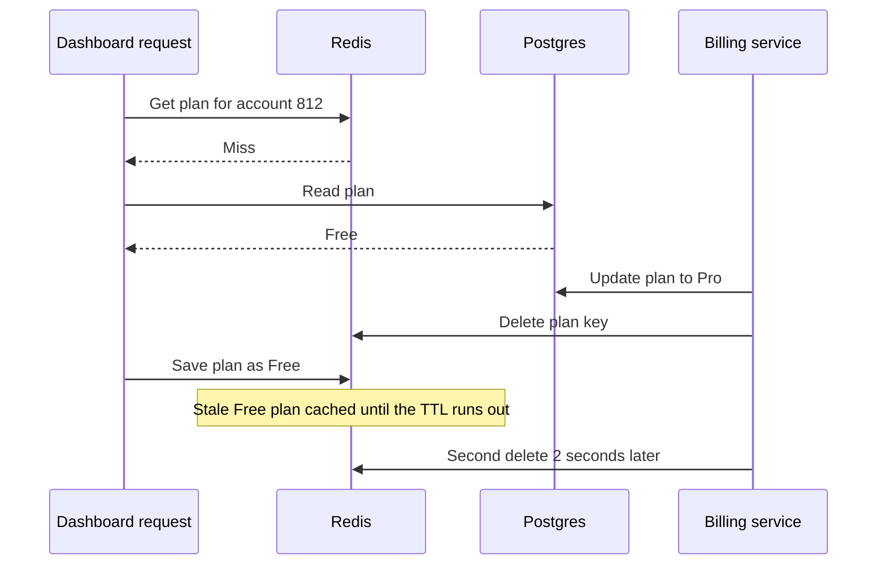

# Cache Invalidation

> Cache invalidation means removing a cached copy when the real data changes. Get it wrong and users keep seeing old prices, old names, or the plan they already paid to upgrade from.

## How it works

There are three main ways to do it:

- **TTL.** Every entry expires after a set time, like 5 minutes. Simple, and it fixes itself, but data can be stale for up to the full TTL.
- **Explicit delete.** When the app writes to the database, it deletes the cached key right after. Fresh almost instantly, but every code path that writes has to remember, including scripts and admin tools.
- **Event driven.** Changes flow out of the database as events, through change data capture and a message queue, and a listener deletes the matching keys. It catches every writer, even ones that bypass your app, at the cost of more moving parts and a small delay.

Most teams combine them: deletes or events for freshness, plus a TTL as a safety net so a missed delete heals itself.

Delete, don't update. Writing the new value into the cache seems efficient, but two writers racing can leave the older value in place. A delete just makes the next read fetch fresh data.

The catch: even delete on write has a race, and it is the classic stale data bug. A slow read misses the cache and fetches the old row. A writer updates the database and deletes the key. Then the slow read puts the old row into the cache, where it sits until the TTL runs out. Keep the TTL short as a backstop, delete a second time a moment after each write, or store a version number so an older value can never replace a newer one.

## Example

A SaaS dashboard caches each account's plan in Redis for 24 hours, so every page can check feature limits without a database query. When a customer upgrades, the billing service updates Postgres and deletes the cached plan. Textbook.

Yet a few customers a week upgrade to Pro, pay $49, and still see the Free plan for the rest of the day. The cause is the race in the diagram below. A dashboard tab read "Free" from the database a few milliseconds before the upgrade landed, then wrote it into the cache a few milliseconds after the delete.

The team cuts the TTL to 10 minutes and adds a second delete 2 seconds after every plan change. A stale copy now lives for 2 seconds instead of 24 hours, and the support tickets stop.

## Picture it

The dashboard request read the old plan just before the upgrade and saved it just after the delete. Without the second delete, that stale copy would stay in Redis for the full TTL.

## Related

[Caching Strategies](caching-strategies.md) · [Cache Stampede](cache-stampede.md) · [Change Data Capture](../09-data-at-scale/change-data-capture.md) · [Race Conditions](../12-concurrency/race-conditions.md) · [Eventual Consistency](../10-distributed-systems/eventual-consistency.md)

---

[← Cache Eviction](cache-eviction.md) · [All concepts](../../README.md) · [Cache Stampede →](cache-stampede.md)
