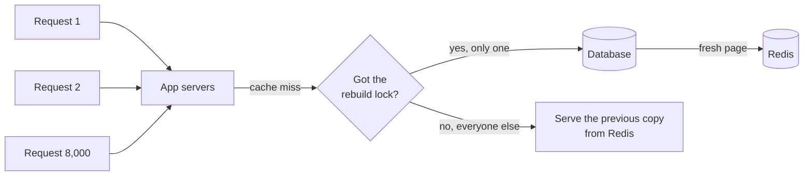

# Cache Stampede

> A cache stampede happens when a popular cached value expires and thousands of requests miss at the same moment, all rushing the database to rebuild it. The database falls over right when traffic is highest.

## How it works

Picture a key read 10,000 times a second with a 60 second TTL. While it is cached, the database sees nothing. The instant it expires, every request misses until someone puts it back. If the rebuild takes 300 ms, that is about 3,000 identical queries landing on the database at once, all computing the same value. The database slows down, rebuilds take longer, more requests miss, and it spirals. This is also called a thundering herd.

The fixes, usually combined:

- **Request coalescing.** Inside each server, if a rebuild for a key is already running, other requests wait for its result instead of starting their own. With 50 servers, that is at most 50 queries, not 3,000. Go's `x/sync/singleflight` package does exactly this.
- **A lock.** Across servers, the first request to miss grabs a short lock in Redis, like `SET lock:page 1 NX PX 5000`, and rebuilds. Everyone else gets the old value, kept a little past its expiry for this, or waits briefly and checks again.
- **Early refresh.** Rebuild the value before it expires. A background job can do it, or each request can refresh early with a small chance that grows as expiry gets close, so one request does it ahead of the crowd.
- **Jittered TTLs.** Add randomness, like 55 to 65 seconds instead of exactly 60, so keys cached together don't all expire together.

The catch: one fixed TTL on everything you load at startup. A cache warmed at 9:00:00 with a 1 hour TTL becomes a cache that empties itself at 10:00:00 sharp.

## Example

A ticketing site caches the event page for a stadium tour, with the seat map and prices, for 30 seconds. Tickets go on sale at 10:00, and the page gets 20,000 requests a second. Building it takes 6 queries and 400 ms.

At 10:02:30 the key expires. In the 400 ms the rebuild takes, 8,000 requests miss and fire 48,000 queries at the database. Query times jump to 3 seconds, so even more requests miss, and the site goes down during the biggest sale of the year.

The fix: a Redis lock per key so only one request rebuilds, while everyone else gets the previous copy, kept 10 seconds past its expiry. A background job also refreshes the page every 20 seconds, so it rarely expires at all, and every TTL gets 10% random jitter. At the next big sale, the database sees one rebuild every 20 seconds per event.

## Picture it

Thousands of requests miss at once, but only the one holding the lock goes to the database. Everyone else gets the slightly old copy, so the database sees one rebuild instead of thousands.

## Related

[Cache Invalidation](cache-invalidation.md) · [Caching](caching.md) · [Distributed Locks](../11-coordination/distributed-locks.md) · [Hot Spots](../09-data-at-scale/hot-spots.md) · [Load Shedding](../14-reliability/load-shedding.md)
