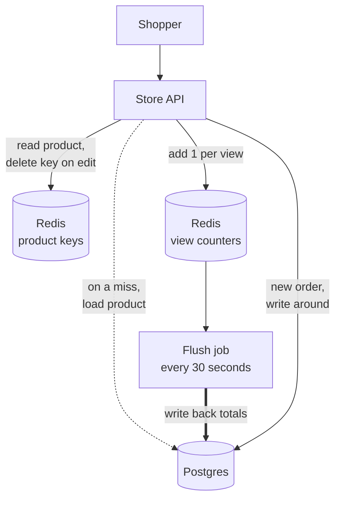

# Caching Strategies

> A caching strategy is the rule for how reads and writes move between your cache and your database. Pick the wrong one and you serve stale data, lose writes, or fill the cache with junk.

## How it works

- **Cache aside.** The app checks the cache. On a miss, it reads the database and puts the result in the cache. On a write, it updates the database and deletes the cached key so the next read loads fresh data. The most common pattern, and if the cache goes down, the app still works, just slower.
- **Read through.** Like cache aside, but the cache loads from the database itself on a miss. App code gets simpler, but you need a cache library or service that supports it.
- **Write through.** Every write goes to the cache and the database together before it counts as done. Reads are always fresh, but every write pays for two stores, and you cache data that may never be read.
- **Write back.** Writes go to the cache only, and the cache flushes them to the database later, in batches. Writes are very fast. If the cache dies before a flush, those writes are gone.
- **Write around.** Writes go straight to the database and skip the cache, which only fills on reads. Good for data written often and read rarely, like logs.

Most systems mix them per kind of data. Cache aside for reads, with a delete on every write, covers most apps.

Watch out: write back looks free in benchmarks. Then a cache node restarts and the last 30 seconds of writes vanish. Use it only for data you can afford to lose or rebuild, like view counters, never for orders or balances.

## Example

An online store uses three strategies side by side.

Product details are read 5,000 times a second and edited a few times a day. That is cache aside: the API checks Redis, loads from Postgres on a miss, and deletes the key when a merchant edits the product. The hit ratio sits around 98%.

The "viewed 340 times today" badge on each product goes up on every page view. Writing each view to Postgres would mean 5,000 writes a second. Instead, Redis increments a counter, and a job writes the totals to Postgres every 30 seconds. That is write back. If Redis restarts, the store loses up to 30 seconds of view counts, and nobody cares.

Orders use write around. They go straight to Postgres, because a lost order is a real problem and nobody reads an order 5,000 times a second.

## Picture it

Product reads use cache aside: Redis first, Postgres on a miss. View counts land in Redis, and a flush job writes them back in batches. Orders skip the cache and go straight to Postgres.

## Related

[Caching](caching.md) · [Cache Invalidation](cache-invalidation.md) · [Cache Eviction](cache-eviction.md) · [Cache Stampede](cache-stampede.md) · [Eventual Consistency](../10-distributed-systems/eventual-consistency.md)

---

[← Caching](caching.md) · [All concepts](../../README.md) · [Cache Eviction →](cache-eviction.md)
