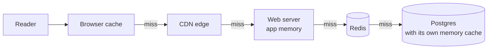

# Caching

> A cache keeps a copy of data somewhere faster and closer than where it really lives. Reads that hit the copy skip the slow trip, which makes apps quicker and keeps databases from melting.

## How it works

A database query might take 20 to 100 ms. Reading the same answer from memory takes well under a millisecond. A cache saves the answer the first time someone asks, so the next thousand people asking get it fast.

Caches live at every layer between the user and the data:

- **Browser.** Keeps images, scripts, and API responses on the user's device, controlled by headers like `Cache-Control: max-age=3600`.
- **CDN.** Servers in hundreds of cities keep copies of pages and files close to users.
- **App memory.** A map inside your server process. The fastest option, but each server has its own copy, and it vanishes on restart.
- **Shared cache.** Redis or Memcached, one in memory store that all your servers share. A read usually takes under a millisecond.
- **Database.** The database keeps recently used data in memory, so repeat queries skip the disk.

The number that matters is the hit ratio, the share of reads the cache answers. At 95%, only 1 in 20 reads reaches the database. At 80%, 1 in 5 does, which is 4 times the database load. Small changes in hit ratio make big changes downstream.

Every cache trades freshness for speed. The copy can be out of date, and deciding how out of date is acceptable is the hard part.

The catch: caching things nobody asks for twice. If every user sees a unique page, the hit ratio is near zero and you pay for the cache and the miss. Cache what is read often and changes rarely.

## Example

A news site builds each article page from 6 database queries, taking 120 ms. Normally that's fine. Then a big story breaks, and one article gets 30,000 views a second.

Without a cache, that is 180,000 queries a second, and the database falls over within minutes. With the rendered page cached in Redis for 60 seconds, the site builds it about once a minute and serves every other request from memory in 1 ms. Put a CDN in front with the same 60 second lifetime, and most requests never reach the servers at all.

The editors fix a typo, and readers see the fix within a minute. For a news article, a minute of staleness is a fine price for staying online.

## Picture it

Each layer answers what it can and passes only its misses down the line. The further left a request is answered, the faster it is and the less work the database does.

## Related

[Caching Strategies](caching-strategies.md) · [Cache Eviction](cache-eviction.md) · [Cache Invalidation](cache-invalidation.md) · [CDN](../03-traffic/cdn.md) · [Zipf's Law](../23-laws/zipfs-law.md)

---

[← Serialization Formats](../05-apis/serialization-formats.md) · [All concepts](../../README.md) · [Caching Strategies →](caching-strategies.md)
