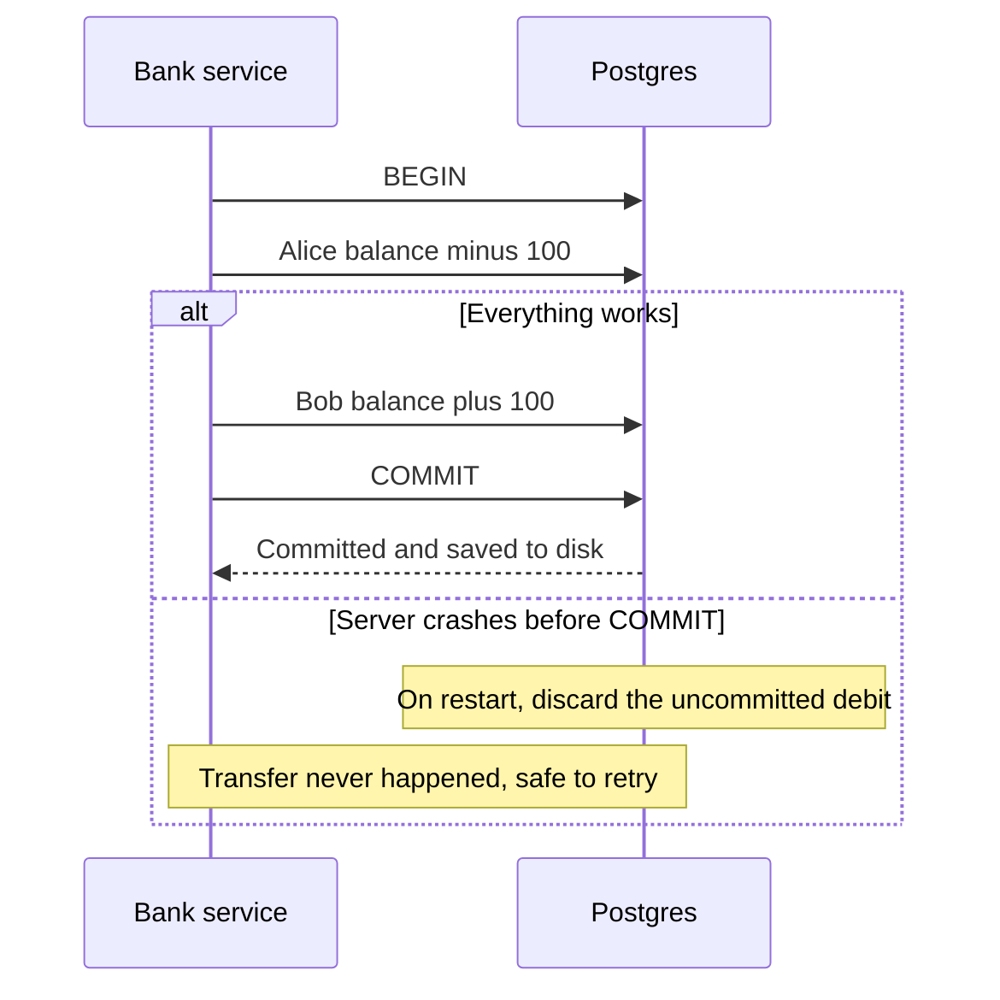

# ACID Transactions

> A transaction groups several database changes so they all happen or none do. ACID is the four promises that make that true, even when users collide or the server loses power.



## How it works

You open a transaction with `BEGIN`, make your changes, and finish with `COMMIT`. Until the commit, nothing is final. ACID names the four guarantees you get:

- **Atomicity.** All or nothing. If anything fails halfway, the database rolls back every change in the transaction.
- **Consistency.** The data moves from one valid state to another. Rules you declared, like "balance can't go below zero" or "every order points at a real customer", never break.
- **Isolation.** Transactions running at the same time don't see each other's half finished work. How strict this is depends on the isolation level.
- **Durability.** Once the database says "committed", the change survives a crash, because it was written to disk first, usually to a write ahead log.

Consistency is partly your job. The database only enforces the rules you give it, as constraints like `CHECK`, `UNIQUE`, and foreign keys.

Atomicity is the one that changes how you write code. You never write cleanup logic for "the debit worked but the credit didn't", because that state can't exist.

The catch: a transaction only covers the database it runs in. If you send an email or call a payment provider in the middle, a rollback can't take it back. Do outside work after the commit, or record it in the same transaction and send it later with an outbox.

## Example

A bank moves $100 from Alice to Bob. That's two updates, and they have to succeed together.

```sql
BEGIN;
UPDATE accounts SET balance = balance - 100 WHERE id = 'alice';
UPDATE accounts SET balance = balance + 100 WHERE id = 'bob';
COMMIT;
```

Without a transaction, a crash between the two updates makes $100 vanish. With one, the database restarts, sees the transfer never committed, and discards the debit. Alice keeps her money, Bob never got it, and the app can simply retry.

Now say Alice only has $60. In Postgres, a `CHECK (balance >= 0)` constraint makes the first update fail, the whole transaction rolls back, and Bob's row is never touched.

If two transfers from Alice run at once, the second one waits on her row until the first commits, then works from the updated balance. No money is created or lost.

## Picture it



There is a moment where Alice has lost $100 and Bob hasn't gained it yet. Atomicity means that moment can never become permanent: either the commit lands, or the database rolls the debit back.

## Related

[Isolation Levels](isolation-levels.md) · [Write Ahead Log](../08-storage/write-ahead-log.md) · [Distributed Transactions](../11-coordination/distributed-transactions.md) · [Outbox Pattern](../13-messaging/outbox-pattern.md) · [Race Conditions](../12-concurrency/race-conditions.md)

---

[← SQL vs NoSQL](sql-vs-nosql.md) · [All concepts](../../README.md) · [Isolation Levels →](isolation-levels.md)
