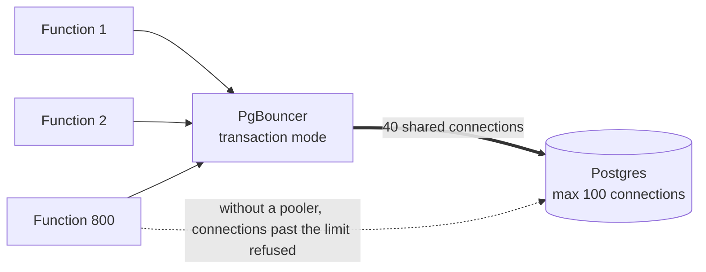

# Connection Pooling

> A connection pool keeps a few database connections open and lends them to requests, instead of opening a fresh one each time. It saves time on every query and keeps the database from drowning in connections.

## How it works

Opening a database connection is slow work. There's a TCP handshake, a TLS handshake, and a login. Postgres then starts a whole new server process for the connection, which costs several megabytes of memory. All of that can take tens of milliseconds, often longer than the query you wanted to run.

A pool opens, say, 10 connections at startup and keeps them. Each request borrows one, runs its queries, and hands it back. No handshakes, no login, no new process.

Sizing is where people go wrong:

- **Bigger isn't faster.** A database with 8 CPU cores can only run so many queries at once. Past a few connections per core, extra ones just wait in line and compete for memory.
- **Multiply by instances.** A pool of 20 per server times 15 servers is 300 connections. Postgres allows 100 by default.
- **Add a pooler.** PgBouncer sits between your apps and Postgres, so thousands of client connections share a few dozen real ones. In transaction mode, a client holds a real connection only for the length of one transaction.

Serverless makes all of this worse. Every function instance is its own process with its own connection, and a traffic spike can start 1,000 of them in seconds. A pooler like PgBouncer or Amazon RDS Proxy absorbs that flood before it reaches the database.

The catch: in transaction mode, your next transaction may run on a different real connection. Anything tied to a session, like a `SET` command or an advisory lock, doesn't carry over.

## Example

A food delivery app runs its API on serverless functions, and each function opens its own Postgres connection. Most of the day, 60 functions run at once. At 7 pm on a Friday, 800 do.

Near 100 connections, new ones get refused with errors like `FATAL: sorry, too many clients already`. Orders start failing right in the dinner rush.

The fix is PgBouncer in transaction mode between the functions and the database:

```ini
[pgbouncer]
pool_mode = transaction
max_client_conn = 2000
default_pool_size = 40
```

Now 800 functions connect to PgBouncer, which funnels them into 40 real Postgres connections. Each query takes about 5 ms, so 40 connections can serve around 8,000 queries a second. The database runs calmer with 40 busy connections than it did with 100 fighting ones.

## Picture it



Hundreds of functions each think they have their own connection, but PgBouncer hands out only 40 real ones, one transaction at a time. The dotted arrow is life without it.

## Related

[Serverless Limits](../15-architecture/serverless-limits.md) · [Autoscaling](../02-scaling/autoscaling.md) · [Read Replicas](../09-data-at-scale/read-replicas.md) · [Query Optimization](query-optimization.md) · [Backpressure](../13-messaging/backpressure.md)

---

[← N+1 Queries](n-plus-one-queries.md) · [All concepts](../../README.md) · [Normalization vs Denormalization →](normalization-vs-denormalization.md)
