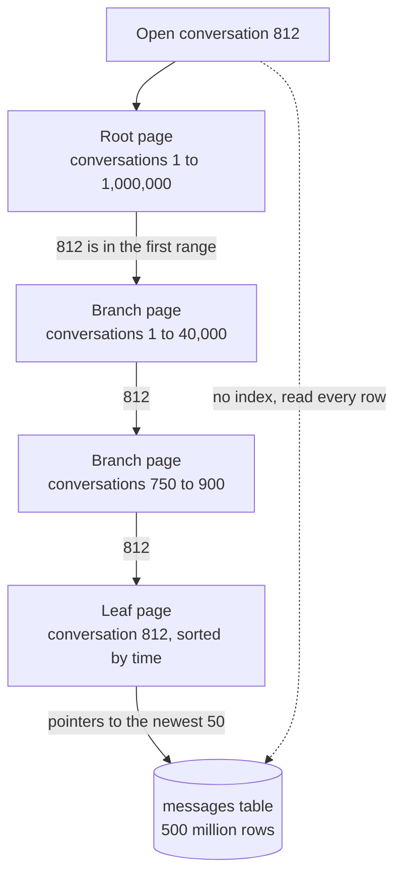

# Database Indexing

> An index is a sorted copy of one or more columns that points back to the full rows. It turns "read every row" into "jump straight there", and every index you add slows down writes.

## How it works

Without an index, `WHERE email = 'sam@example.com'` means a full table scan: the database reads every row and checks each one. Fine for 1,000 rows. A disaster for 50 million.

Most indexes are B trees. A B tree keeps the indexed values in sorted order inside a shallow tree of disk pages. To find a value, the database starts at the root page and follows pointers down, usually 3 or 4 levels even for millions of rows, then hops to the actual row. Because the values are sorted, ranges like "created after Monday" and `ORDER BY` come almost free.

A composite index covers several columns, and the order matters. An index on `(conversation_id, created_at)` is sorted by conversation first, then by time inside each conversation. It helps queries that filter on `conversation_id`, or on both columns. It barely helps a query on `created_at` alone, the same way a phone book sorted by last name is no shortcut to everyone called Sam. Put the column you match exactly first and the one you sort or range over second.

Indexes aren't free. Every insert has to update every index on the table, as do many updates and deletes, and each index eats disk and memory. A table with 8 indexes does 9 writes for every new row.

The catch: teams add an index for every slow query and never remove one. Check which indexes your queries actually use (Postgres counts this in `pg_stat_user_indexes`) and drop the rest.

## Example

A chat app stores 500 million messages. Opening a conversation runs:

```sql
SELECT * FROM messages
WHERE conversation_id = 812
ORDER BY created_at DESC
LIMIT 50;
```

With no index, the database scans the whole table to find conversation 812, then sorts. Tens of seconds per tap, with the disk busy the whole time.

Add the right index:

```sql
CREATE INDEX messages_conv_time ON messages (conversation_id, created_at);
```

Now the database walks down to conversation 812, where its messages already sit in time order, and reads the last 50 entries. About a millisecond.

If someone builds it as `(created_at, conversation_id)` instead, the index is sorted by time first. Conversation 812's messages are scattered all through it, so the database may still wade through millions of entries to find 50.

## Picture it



With the index, the query touches four small pages on the way down and lands on conversation 812's messages already in order. The dotted arrow is the path without one: all 500 million rows.

## Related

[Query Optimization](query-optimization.md) · [Database Migrations](database-migrations.md) · [Storage Engines](../08-storage/storage-engines.md) · [Full Text Search](../08-storage/full-text-search.md) · [Geospatial Indexing](../08-storage/geospatial-indexing.md)
