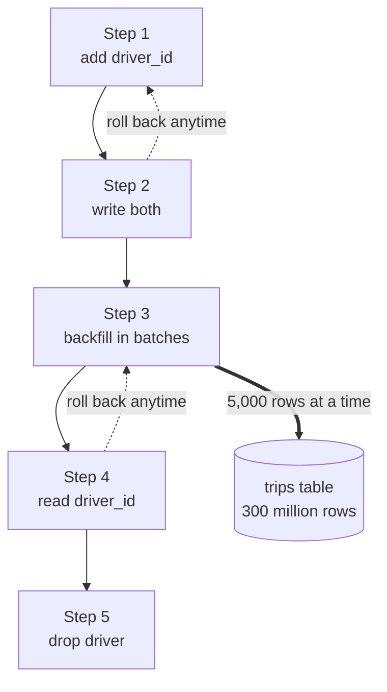

# Database Migrations

> A database migration changes the schema of a live database: adding columns, renaming them, building indexes. Done carelessly, it locks a busy table or breaks the servers still running old code.

## How it works

Two things make migrations on a running system tricky. First, some schema changes lock the table. In Postgres, many `ALTER TABLE` commands take an `ACCESS EXCLUSIVE` lock that blocks even reads, and a plain `CREATE INDEX` blocks writes until it finishes, which can take an hour on a big table. Second, deploys aren't instant. For a few minutes, old and new versions of your app run side by side against the same schema, so the schema has to work for both.

The safe pattern is expand and contract. Never change something in place. Add the new thing, move over, and remove the old thing last:

1. **Expand.** Add the new column or table. Old code ignores it.
2. **Dual write.** Deploy code that writes to both the old and the new place.
3. **Backfill.** Copy old rows over in small batches, a few thousand at a time, so no single transaction runs long.
4. **Switch reads.** Deploy code that reads from the new place.
5. **Contract.** Stop writing the old place, then drop it.

Each step is a small, boring deploy, and every step before the last can be rolled back. For indexes, Postgres has `CREATE INDEX CONCURRENTLY`, which builds without blocking writes, just more slowly.

Watch out: a migration waiting for a lock blocks everyone behind it. If a long report is reading the table, your `ALTER TABLE` waits, and every normal query lines up behind the `ALTER`. Set `lock_timeout` to a few seconds so the migration gives up fast and retries, instead of freezing the app.

## Example

A ride sharing app wants to rename `trips.driver` to `trips.driver_id`. The table has 300 million rows.

The quick way is one `RENAME COLUMN` plus a deploy. The rename itself is instant. But during the 6 minute rolling deploy, half the servers still run old code that asks for `driver`, and every trip request they handle fails.

The safe way spreads it over a week. Add `driver_id` as a nullable column, which is instant. Deploy code that writes both columns. Backfill the old rows 5,000 at a time with a short pause between batches, so replicas keep up. Deploy code that reads `driver_id`. A week later, once nothing touches `driver`, drop it.

At no point does any running server see a schema it doesn't understand.

## Picture it

Every box is a small deploy that old and new servers can both live with. The dotted arrows are the point: until step 5 drops the old column, you can back out of any step without losing data.

## Related

[Schema Versioning](schema-versioning.md) · [Rolling Deployments](../20-releases/rolling-deployments.md) · [Feature Flags](../20-releases/feature-flags.md) · [Rollbacks](../20-releases/rollbacks.md) · [Database Indexing](database-indexing.md)

---

[← Materialized Views](materialized-views.md) · [All concepts](../../README.md) · [Schema Versioning →](schema-versioning.md)
