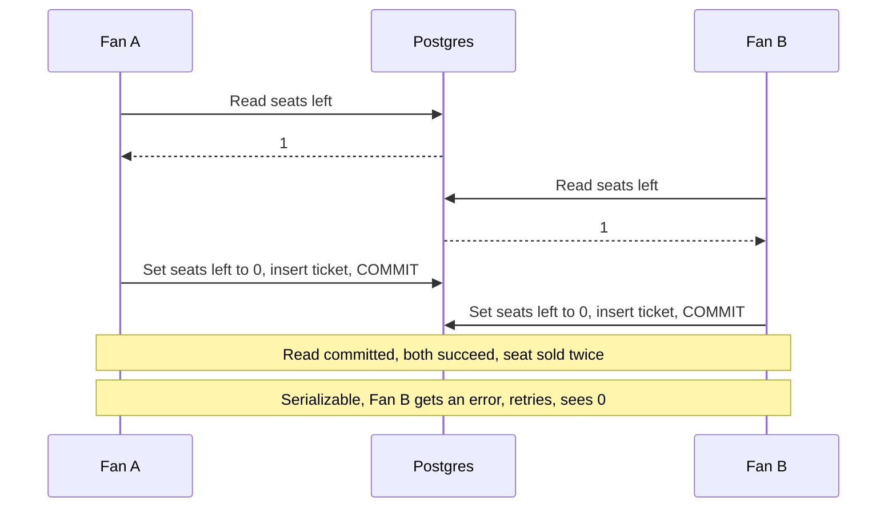

# Isolation Levels

> Isolation levels decide how much transactions running at the same time can see of each other's work. Stricter levels prevent more strange bugs and cost you more waiting, retries, or both.

## How it works

Running transactions one at a time would be perfectly safe and painfully slow. So databases let them overlap, and the isolation level says which side effects of that overlap you accept.

A **dirty read** is seeing another transaction's change before it commits, when it might still roll back. A **non repeatable read** is reading the same row twice and getting two values, because someone committed in between. A **phantom** is running the same `WHERE` query twice and getting new rows the second time. A **lost update** is two transactions reading a value, both changing it, and the second write silently erasing the first.

| Level | Dirty reads | Non repeatable reads | Phantoms |
|---|---|---|---|
| Read uncommitted | Possible | Possible | Possible |
| Read committed | Blocked | Possible | Possible |
| Repeatable read | Blocked | Blocked | Possible |
| Serializable | Blocked | Blocked | Blocked |

That table is the minimum the SQL standard asks for, and real databases often block more. Lost updates vary the most: Postgres catches them at repeatable read and aborts one transaction, while MySQL at the same level lets them through.

Serializable promises the result matches some one at a time order. You pay with lock waits or with aborted transactions your code has to retry.

Watch out: almost nobody defaults to serializable. Postgres, Oracle, and SQL Server default to read committed, MySQL to repeatable read. Code that reads a value, decides, then writes is not safe at those levels unless you lock the row.

## Example

A ticketing site has one seat left for a concert. Two fans click "Buy" within the same 20 ms.

Both checkouts run at read committed, the Postgres default. Each one reads `seats_left = 1`, decides there's room, writes `seats_left = 0`, and inserts a ticket. Both commit. One seat, two tickets, one awkward evening at the venue.

The cheapest fix is to let the database do the check in one statement: `UPDATE events SET seats_left = seats_left - 1 WHERE id = 7 AND seats_left > 0`, and only issue a ticket if a row changed. Another is to lock the row first with `SELECT ... FOR UPDATE`, so the second fan waits and then reads 0. Or run checkout at serializable: the second transaction gets a serialization error, the app retries, and the retry sees the seat is gone.

## Picture it

Both fans read the same 1 before either one writes. At read committed nothing stops the second write from landing on top of the first. At serializable the database notices the overlap and makes Fan B start over.

## Related

[ACID Transactions](acid-transactions.md) · [Race Conditions](../12-concurrency/race-conditions.md) · [Optimistic Locking](../12-concurrency/optimistic-locking.md) · [Pessimistic Locking](../12-concurrency/pessimistic-locking.md) · [MVCC](mvcc.md)
