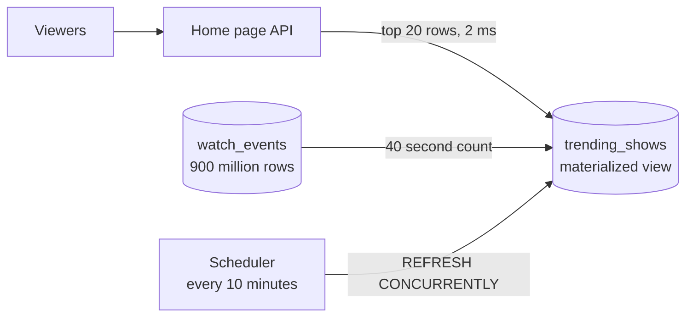

# Materialized Views

> A materialized view saves the result of an expensive query as a real table. Reads become nearly instant, and the price is that the data is only as fresh as the last refresh.



## How it works

A normal view is a saved query with a name. Every time you select from it, the database runs the full query again. A materialized view runs the query once and stores the rows on disk. Reading it costs the same as reading any small table, and you can index it.

Those stored rows don't update themselves when the source tables change. You decide when to refresh:

- **On a schedule.** A job reruns the query every 10 minutes, or every night. Simple and predictable.
- **After big writes.** Refresh when a batch import finishes, so the view matches the new data.
- **Incrementally.** Some databases, like Oracle and ClickHouse, can update the view as new rows arrive instead of recomputing it. Postgres has no built in incremental refresh, so it reruns the whole query.

Staleness is the deal you sign. With a 10 minute refresh, readers can see data up to 10 minutes old, plus however long the refresh itself takes. Great for dashboards, rankings, and reports. Wrong for an account balance.

Refreshing isn't free either, since it runs the full expensive query each time. If the query takes 3 minutes, refreshing every minute is not a plan.

The catch: in Postgres, a plain `REFRESH MATERIALIZED VIEW` locks the view, so every read waits until the refresh finishes. Use `REFRESH MATERIALIZED VIEW CONCURRENTLY`, which needs a unique index on the view but lets reads carry on.

## Example

A video streaming site shows a "Trending this week" row on its home page. Building it means counting 900 million watch events from the last 7 days, which takes about 40 seconds. Running that on every home page load is out of the question.

So the team stores the answer:

```sql
CREATE MATERIALIZED VIEW trending_shows AS
  SELECT show_id, count(*) AS views
  FROM watch_events
  WHERE watched_at > now() - interval '7 days'
  GROUP BY show_id;

CREATE UNIQUE INDEX ON trending_shows (show_id);

-- run every 10 minutes
REFRESH MATERIALIZED VIEW CONCURRENTLY trending_shows;
```

The home page reads the top 20 rows in 2 ms. A show that goes viral can take a little over 10 minutes to appear in the row, and nobody minds.

## Picture it



Viewers only ever touch the small precomputed table. The slow 40 second count still happens, but in the background on a timer, never while a viewer waits.

## Related

[Normalization vs Denormalization](normalization-vs-denormalization.md) · [Caching](../06-caching/caching.md) · [CQRS](../13-messaging/cqrs.md) · [OLTP vs OLAP](../08-storage/oltp-vs-olap.md) · [Cron Jobs](../13-messaging/cron-jobs.md)

---

[← Normalization vs Denormalization](normalization-vs-denormalization.md) · [All concepts](../../README.md) · [Database Migrations →](database-migrations.md)
