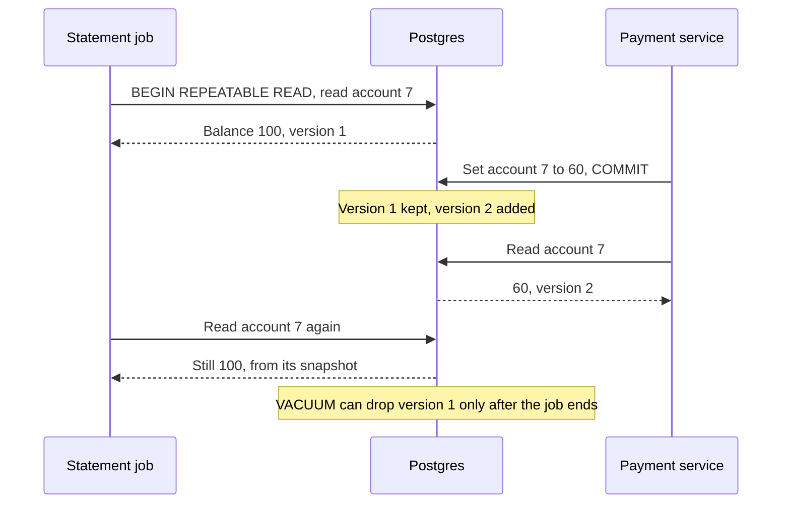

# MVCC

> MVCC lets a database keep several versions of each row, so readers see a consistent snapshot while writers keep working. Readers and writers don't wait on each other, but old versions pile up and have to be cleaned away.



## How it works

With only one copy of each row, a reader has to wait while a writer changes it, or the writer waits for the reader. MVCC, multiversion concurrency control, keeps several copies instead.

An update doesn't throw the old row away. It writes a new version and keeps the old one, marked as replaced, and every version is stamped with the transaction that created it. When a transaction reads, it uses a snapshot: a record of which transactions had committed at that moment. Each read returns the newest version committed as of that snapshot. In Postgres, read committed takes a fresh snapshot for every statement, and repeatable read keeps one for the whole transaction.

The payoff, as the Postgres docs put it: reading never blocks writing, and writing never blocks reading. A 10 minute report and a stream of payments run side by side. Two writers on the same row still take turns.

Old versions have to go once no snapshot can see them:

- **Postgres.** Old versions stay in the table itself. `VACUUM`, usually run for you by autovacuum, marks their space free for reuse.
- **MySQL InnoDB.** Old versions live in an undo log, and older rows are rebuilt from it when a snapshot needs them. A purge thread throws them away later.

The catch: a transaction left open keeps its snapshot, and no version replaced after it started can be cleaned up, anywhere in the database. One forgotten session makes tables swell for hours. Postgres can kill sessions that sit idle inside a transaction with `idle_in_transaction_session_timeout`, but that setting is off by default.

## Example

A bank runs Postgres. At 01:00 a statement job opens a repeatable read transaction, so every query sees the same moment, and then hangs waiting on a PDF service that never answers. Nobody notices.

The `balances` table takes 3,000 updates a second. Each one leaves a dead version behind, and autovacuum can't remove any of them while the job's snapshot is open. By 09:00 there are over 80 million. The table has grown from 4 GB to 13 GB, and lookups that took 2 ms now take 30.

They kill the stuck session and autovacuum clears the backlog. The space gets reused, but the file rarely shrinks without `VACUUM FULL`, which locks the table while it rewrites it. Then they add a timeout and an alert:

```sql
ALTER SYSTEM SET idle_in_transaction_session_timeout = '5min';
SELECT pg_reload_conf();

SELECT pid, now() - xact_start AS open_for, state
FROM pg_stat_activity
WHERE xact_start < now() - interval '10 minutes';
```

## Picture it



The payment service never waits for the job, and the job never waits for it. They simply read different versions. The cost is version 1, which has to stay on disk until the job's snapshot closes.

## Related

[Isolation Levels](isolation-levels.md) · [ACID Transactions](acid-transactions.md) · [Optimistic Locking](../12-concurrency/optimistic-locking.md) · [Pessimistic Locking](../12-concurrency/pessimistic-locking.md) · [Storage Engines](../08-storage/storage-engines.md)

---

[← Isolation Levels](isolation-levels.md) · [All concepts](../../README.md) · [Database Indexing →](database-indexing.md)
