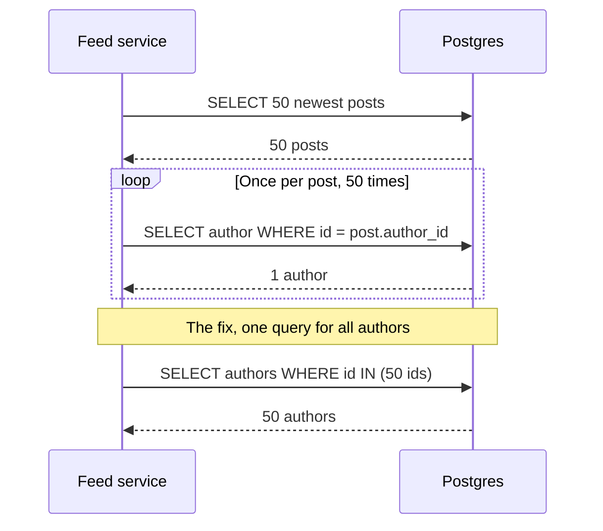

# N+1 Queries

> An N+1 query happens when code fetches a list with one query, then runs one more query for every item in it. It looks harmless with 3 rows and buries your database with 3,000.

## How it works

ORMs, the libraries that turn database rows into objects, make this easy to write by accident. You load 50 posts. Then your template loops over them and prints `post.author.name`. The ORM hasn't loaded authors yet, so each access quietly fires its own query. That's 1 query for the list plus 50 for the authors: N+1.

Each query is fast, maybe 2 ms. The problem is the round trips. Fifty one queries at 2 ms each is over 100 ms of pure waiting, and a page that also shows comments and likes can hit 500 queries. Every one of them also takes a connection and some database CPU.

The fixes all come down to "ask for everything at once":

- **Eager loading.** Tell the ORM up front which related data you need. It fetches authors with a join, or with one extra `WHERE id IN (...)` query. Rails calls it `includes`. Django has `select_related` and `prefetch_related`.
- **Batching.** Collect all the IDs first, then load them in one query. GraphQL servers often use DataLoader, a small library that gathers keys from many resolvers and sends a single request.
- **Detection.** Log the number of queries per request. Tools like the Bullet gem for Rails flag N+1 patterns while you develop.

The catch: it never shows up on your laptop. With 5 test posts it's 6 quick queries. In production the list has 200 items, the page runs 201 queries, and nobody changed a line of code.

## Example

A social feed shows the 50 newest posts, each with the author's name and avatar. The Django view:

```python
posts = Post.objects.order_by("-created_at")[:50]   # 1 query
for post in posts:
    print(post.author.name)                         # 50 more queries
```

The feed takes 160 ms, and the database sees 51 queries per page view. At 2,000 feed loads a second, that's over 100,000 queries a second for work that should take 2,000.

One change:

```python
posts = Post.objects.select_related("author").order_by("-created_at")[:50]
```

Django now fetches posts and their authors in a single query with a join. The feed drops to about 12 ms, and the database runs one query per page view instead of 51.

## Picture it



The loop is the bug. Each trip to the database is quick, but 50 of them in a row add up. The fix at the bottom asks for all 50 authors in one trip.

## Related

[Query Optimization](query-optimization.md) · [Database Indexing](database-indexing.md) · [Connection Pooling](connection-pooling.md) · [GraphQL](../05-apis/graphql.md) · [Law of Leaky Abstractions](../23-laws/law-of-leaky-abstractions.md)
