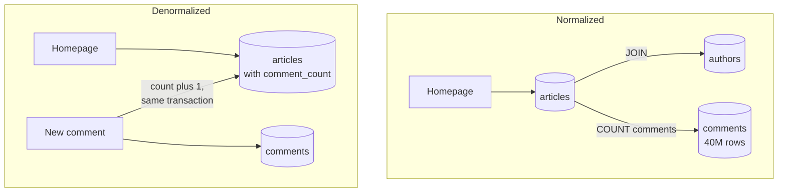

# Normalization vs Denormalization

> Normalization stores each fact in exactly one place and joins tables when you read. Denormalization copies facts to where they're read, trading extra writes and the risk of drift for faster queries.

## How it works

In a normalized schema, an author's name lives in the `authors` table and nowhere else. Articles store only `author_id`, and you join to show a byline. Change the name once and every article shows the new one, because there's only one copy to change. Textbooks formalize this as "normal forms", but "store each fact once" covers most of it.

Denormalizing means copying data on purpose so reads get cheaper. Three common shapes:

- **Copied fields.** Store `author_name` on every article so the homepage skips the join.
- **Precomputed totals.** Keep a `comment_count` column instead of counting millions of comment rows on every page view.
- **Embedded documents.** In a document store, keep an order's line items inside the order itself, so one read gets everything.

The tradeoff is simple. Normalized data is easy to keep correct and slower to read. Denormalized data is fast to read, and every write must now update every copy. Normalize by default, and denormalize one read path at a time, after you've measured it being slow.

Not every copy is denormalization. An order that stores the price at checkout records a different fact, "what the customer paid", and it should never change when the catalog price does.

The catch: copies drift. The app updates the count, then a cleanup script deletes 500 spam comments straight in SQL, and the counts are wrong from then on. Update copies in the same transaction as the source, and keep a job that can rebuild them from scratch.

## Example

A news site homepage lists 30 articles, each with an author name and a comment count. Normalized, the query joins `authors` and counts rows in a 40 million row `comments` table. It takes 300 ms, and the homepage gets 2,000 views a second.

The team adds a `comment_count` column to `articles`. Posting a comment now does two things in one transaction: insert the comment, and add 1 to the count. The homepage reads one table and takes 4 ms.

They leave the author name normalized. Joining 30 authors by primary key is cheap, and copying names would mean rewriting 1,200 articles every time a writer changes their byline. Denormalize the expensive part, not everything.

## Picture it

In the normalized version, every page view pays for the join and the count. In the denormalized one, each new comment pays for one tiny extra write, and every page view after that just reads a number.

## Related

[SQL vs NoSQL](sql-vs-nosql.md) · [Materialized Views](materialized-views.md) · [CQRS](../13-messaging/cqrs.md) · [Caching](../06-caching/caching.md)
