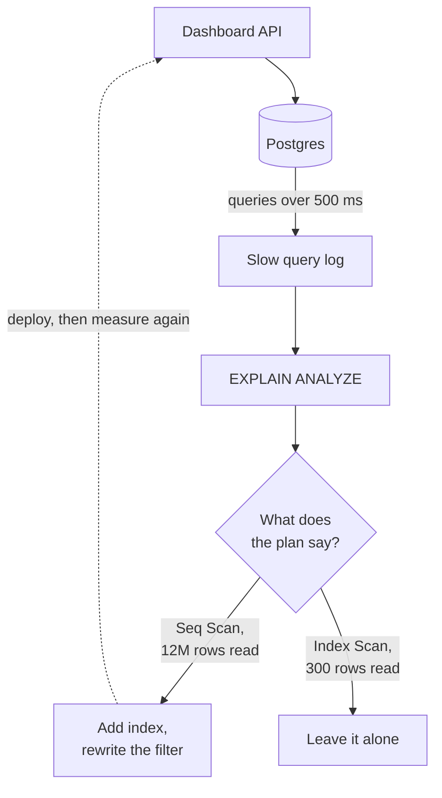

# Query Optimization

> Query optimization is finding out why a query is slow and fixing it, usually by reading the plan the database made for it. Most slow queries read far more rows than they return.

## How it works

Before running a query, the database's planner picks a strategy: which index to use, which table to read first, how to join. `EXPLAIN` shows you that plan. In Postgres, `EXPLAIN ANALYZE` actually runs the query and adds real timings and row counts.

What to look for:

- **Seq Scan on a big table.** A full scan reads every row. Fine on 500 rows, a red flag on 12 million.
- **Index Scan.** The database jumped straight to the matching rows. Usually what you want.
- **Rows Removed by Filter.** Reading 12 million rows to return 300 means an index is missing or not being used.
- **Estimated vs actual rows.** If the planner guessed 10 and got 2 million, its statistics are likely stale. Run `ANALYZE` to refresh them.

Select only the columns you need. `SELECT *` drags every wide text column through memory and over the network. With a short column list, the database can sometimes answer from the index alone and skip the table.

Don't guess which query to fix. Turn on the slow query log (Postgres calls the setting `log_min_duration_statement`) and use `pg_stat_statements` to rank queries by total time. A 20 ms query that runs 50,000 times an hour costs more than one 5 second report.

Watch out: wrapping an indexed column in a function, like `lower(email)` or `date_trunc('month', created_at)`, hides it from a normal index. Compare the raw column instead, or build an index on the expression itself, like one on `lower(email)`.

## Example

A SaaS dashboard's "This month's invoices" page takes 4 seconds. `EXPLAIN ANALYZE` on its query shows why:

```
Seq Scan on invoices  (actual time=0.021..4102.513 rows=300 loops=1)
  Filter: ((account_id = 42) AND (date_trunc('month', created_at) = '2025-06-01'))
  Rows Removed by Filter: 11999700
Execution Time: 4103.118 ms
```

It reads 12 million rows to return 300. The planner isn't broken. With the column hidden inside `date_trunc` and no index on `account_id`, a full scan was its only option. The team rewrites the filter as a plain range on `created_at`, adds an index on `(account_id, created_at)`, and swaps `SELECT *` for the 4 columns the page actually shows.

```
Index Scan using invoices_account_created on invoices
  (actual time=0.034..2.871 rows=300 loops=1)
Execution Time: 3.042 ms
```

Same 300 rows, about 1,300 times faster, and no new hardware.

## Picture it



The loop is the whole job: let the database tell you which queries are slow, ask it how it ran them, fix the plan, and measure again. Guessing skips the two steps that matter.

## Related

[Database Indexing](database-indexing.md) · [N+1 Queries](n-plus-one-queries.md) · [P99 Latency](../01-performance/p99-latency.md) · [Read Replicas](../09-data-at-scale/read-replicas.md) · [Premature Optimization](../24-principles/premature-optimization.md)
