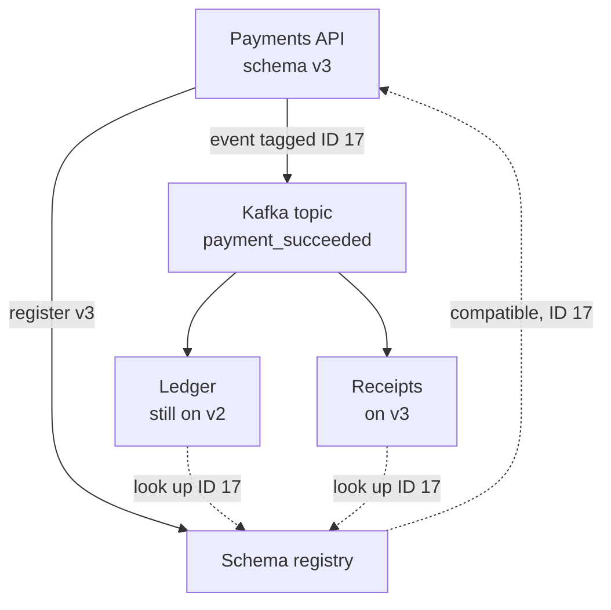

# Schema Versioning

> Schema versioning tracks which shape of data each database holds and each piece of code expects. It lets you change tables and event formats without old readers choking on new data.

## How it works

For databases, every change is a numbered migration file in the repo: `0041_add_phone.sql`, then `0042_index_orders_by_user.sql`. A migration tool such as Flyway, Alembic, or the one built into Rails keeps a small table in each database, like Rails' `schema_migrations`, that records which files have already run. On deploy it runs only the missing ones, in order. Laptop, staging, and production reach the same version by the same path.

Code and data outlive each other, though. During a deploy, old and new versions of a service run at once. Events sit in a Kafka topic for days or weeks. Mobile apps stay on old versions for months. So every format change needs a compatibility rule:

- **Backward compatible.** New readers can read old data. Add fields with a default, so old records without them still parse.
- **Forward compatible.** Old readers can read new data. They skip fields they don't know.
- **Breaking.** Removing a field someone reads, changing its type, or renaming it. To a reader, a rename is a delete plus an add.

A schema registry, like Confluent Schema Registry for Kafka, enforces those rules. Producers register each new version of an event schema, the registry rejects any version that breaks the rule, and every message carries a small schema ID so consumers know how to decode it.

The catch: never edit a migration that already ran somewhere. Your laptop and production would quietly disagree about what version 42 means. Write migration 43 instead. Flyway even stores a checksum of each file and refuses to continue when an applied one changes.

## Example

A payments API publishes a `payment_succeeded` event to Kafka. Six services read it, including the ledger, receipts, and fraud checks. The topic's registry is set to backward compatible, which is Confluent's default.

Version 3 of the event adds a required `currency` field. The producer's build tries to register it, and the registry says no. A consumer on version 3 replaying last week's events would find no currency at all and fail to decode them.

So the team gives `currency` a default of `"USD"`. The registry accepts it as schema ID 17. The ledger, still on version 2, reads new events and skips the field it doesn't know. Receipts, on version 3, reads old events and fills in USD. Nobody had to coordinate a big bang deploy across six teams.

## Picture it

The registry checks every new version before any event uses it. Each event carries only a small ID, and each consumer fetches the matching schema, so the ledger on v2 and receipts on v3 read the same events safely.

## Related

[Database Migrations](database-migrations.md) · [API Versioning](../05-apis/api-versioning.md) · [Serialization Formats](../05-apis/serialization-formats.md) · [Event Streaming](../13-messaging/event-streaming.md)

---

[← Database Migrations](database-migrations.md) · [All concepts](../../README.md) · [Storage Engines →](../08-storage/storage-engines.md)
